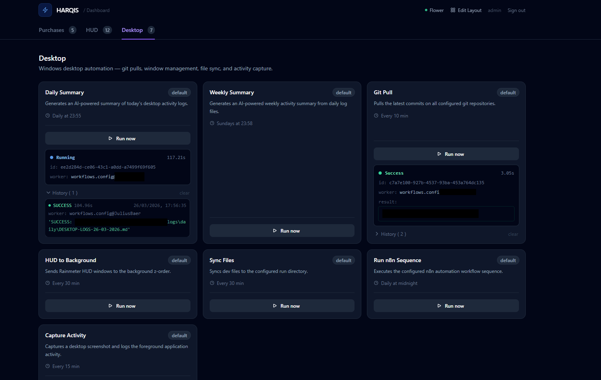

  

# HARQIS Work

HARQIS Work brings your notes, activity, connected services, and recurring tasks
into one workspace. It runs on computers you control and helps you find useful
information, keep track of commitments, and automate repetitive work.

It began as a personal automation system and is an actively developed project.
Setting it up requires technical knowledge; using its web dashboard is the main
way to browse information and manage day-to-day work. Connected services and AI
providers may require their own accounts and paid plans.

## What you can do

- **Keep a searchable record.** Collect notes and activity in the Activity Corpus
  (also called Homework for Life), then find entries, documents, and related ideas.
- **Organize what matters.** Track actions, goals, ideas, and mind maps. Use Spaces
  to group information and the Second Brain dashboard to see relevant context.
- **Connect your tools.** Integrate services such as Google Workspace, Jira,
  Trello, Discord, and YNAB, alongside local files and desktop tools.
- **Automate recurring work.** Run configured routines on a schedule or trigger
  them from the dashboard. Examples include summaries, data collection, and
  trading-card inventory workflows.
- **Work with AI assistants.** Give supported assistants access to configured
  tools and assign work through supported agent runtimes.
- **Share selected information.** Create temporary workspace shares with access
  limits and expiry, rather than giving visitors access to the whole workspace.

Features depend on the integrations, permissions, and workers you configure.
Self-hosting keeps the application under your control; enabled integrations and
AI services can still send data to their providers.

## A first look

Start with the [Spaces guide](docs/info/SPACES-GUIDE.md) to organize information,
the [Second Brain guide](docs/info/SECOND-BRAIN.md) for contextual guidance, and
the [workspace sharing guide](docs/info/WORKSPACE-SHARING-GUIDE.md) to share a
selected set of material. The [documentation index](docs/info/README.md) links
to the rest of the guides.

## How it fits together

The **dashboard** is where you browse and manage work. **Integrations** connect
your services. **Workflows** carry out repeatable jobs. **Agents** can reason
through tasks using the tools you enable. A host runs the shared services, and
optional worker computers handle jobs that need their own operating system or files.

Developers can use the [architecture reference](docs/info/ARCHITECTURE.md),
[integration inventory](docs/info/INTEGRATIONS.md), and
[workflow reference](docs/info/WORKFLOW-REFERENCE.md) for the technical details.
The shared Python foundation is [HARQIS-core](https://github.com/brianbartilet/harqis-core).

## Getting started

1. Read the [installation and configuration guide](docs/info/SETUP.md).
   The Python platform requires Python 3.12 or later; Docker runs shared services.
   Some desktop features are Windows-only.
2. Configure only the services you intend to use. Keep credentials and personal
   machine settings outside Git.
3. Review the [security guide](docs/info/SECURITY.md) before starting services or
   enabling access from other computers. Docker ports default to the local host.
4. Follow the [operations guide](docs/info/OPERATIONS.md) to start the dashboard
   and workers. Begin with a small, understood workflow before enabling schedules.

This repository is not a managed hosting service or a one-click production setup.
The security guide records remaining dependency blockers and release checks.

## Guides and references

| If you want to… | Start here |
|---|---|
| Understand the project's purpose | [Manifesto](docs/MANIFESTO.md) |
| Browse user guides | [Documentation index](docs/info/README.md) |
| Install and configure it | [Setup](docs/info/SETUP.md) |
| Run services, tests, or troubleshoot | [Operations](docs/info/OPERATIONS.md) |
| Deploy a host or worker | [Host deployment](docs/info/HERMES-HOST.md) · [OS support](docs/info/OS-COMPATIBILITY.md) |
| Explore connected services | [Integration inventory](docs/info/INTEGRATIONS.md) |
| Understand schedules and queues | [Workflow and HUD reference](docs/info/WORKFLOW-REFERENCE.md) |
| Use agents and their tools | [Agent reference](docs/info/AGENT-REFERENCE.md) · [Skills guide](docs/info/SKILLS-GUIDE.md) |
| Change or extend the code | [Architecture](docs/info/ARCHITECTURE.md) · [Contributor scripts](scripts/README.md) |
| Prepare a public release | [Security and publication checklist](docs/info/SECURITY.md) |

## Contributing

Read the [manifesto](docs/MANIFESTO.md) before proposing changes. Integration,
workflow, and frontend directories contain their own implementation guides.
Reusable agent instructions live in [`.agents/skills/`](.agents/skills/); support
for discovering and invoking them depends on the agent tool you use.

Keep credentials, captured activity, personal notes, and runtime databases out of
commits and images. Run the relevant checks described in the operations and
security guides before submitting changes.

## Contact and license

Questions or feedback: [LinkedIn](https://www.linkedin.com/in/dbbartilet/).
Distributed under the [MIT License](LICENSE).
