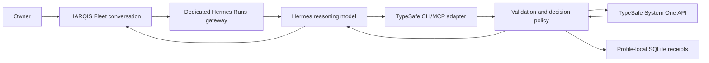

# Jev Decision Assistant in the Hermes fleet

This integration adds a versioned decision tool to an existing Hermes runtime.
Hermes retains its reasoning model; Jev evaluates typed questions. Release one
is manual, recommendation-only action triage, with local decision receipts.

## Architecture and ownership



| Component | Responsibility |
|---|---|
| Fleet | Owner-facing identity, connection credentials, conversation and run status |
| Hermes | Context preparation, tool invocation and explanation using its configured LLM |
| TypeSafe service | Input validation, API transport, answer validation and local receipts |
| Jev | Choice, urgency and yes/no judgments about the supplied context |
| Decision policy | Decide whether to return a recommendation or require review |

The Hermes gateway key and `TYPESAFE_API_KEY` serve different connections. Fleet
stores the gateway key; the execution host resolves the TypeSafe key. Neither
belongs in agent instructions. Jev is invoked as a tool, not selected as the
Hermes reasoning model. The local skill supplies usage instructions, not API access.

## Implementation map

| Source | Purpose |
|---|---|
| [`apps/typesafe/config.py`](../../apps/typesafe/config.py) | Load the `TYPESAFE` app configuration |
| [`base_api_service.py`](../../apps/typesafe/references/web/base_api_service.py) | HTTPS transport, timeouts, bounded retries and sanitized errors |
| [`system_one.py`](../../apps/typesafe/references/web/api/system_one.py) | Model discovery and decision orchestration |
| [`DTO validation`](../../apps/typesafe/references/dto/system_one.py) | Validate answer types, probability distributions and usage |
| [`templates.py`](../../apps/typesafe/templates.py) | `action_triage_v1` questions, thresholds and review reasons |
| [`receipts.py`](../../apps/typesafe/receipts.py) | Persist bounded decision records in SQLite |
| [`mcp.py`](../../apps/typesafe/mcp.py) | Shared CLI/MCP tool registration |
| [`tools/catalog.py`](../../tools/catalog.py) | Lazy registration consumed by CLI, MCP server and agent bridge |
| [`setup_jev_hermes.py`](../../scripts/setup_jev_hermes.py) | Dry-run/apply profile setup |
| [`jev-action-triage`](../../.agents/skills/jev-action-triage/SKILL.md) | Operational instructions installed on the execution profile |

The [app reference](../../apps/typesafe/README.md) contains the full configuration,
input limits, CLI commands, transport behavior and test entry points.

## Flow

1. The owner submits action context and candidate capabilities through Fleet's
   **Conversation → Run task** on the connected Hermes agent.
2. HARQIS submits a durable run to that agent's dedicated Hermes gateway.
3. Hermes loads `jev-action-triage` and calls `analyze_typesafe_decision`.
4. The service validates bounded input, builds the versioned questions, calls
   TypeSafe, validates the answers, applies review policy, and saves a receipt.
5. Hermes explains the result, citing receipt ID, model and uncertainty. Fleet
   shows the conversation and run status. Assignments remain unchanged.

The initial MCP surface contains only model discovery and decision analysis.
Supply candidate context in the task; broader corpus retrieval requires separately
configured tools. No scheduler or automatic delegation is installed.

## Prepare the execution host

Deploy this checkout and its normal virtual environment on the machine that will
run Hermes. Configure `TYPESAFE_API_KEY` in that checkout's `.env/apps.env`. The
MCP launcher uses the existing machine environment resolver; do not paste the
key into Fleet instructions or committed YAML. Select a pinned available model
in the app config after using `list_typesafe_models`.

Create a dedicated profile through Hermes's normal profile setup, for example:

```sh
hermes profile create jev-decisions --no-skills
```

Configure its supported reasoning model using Hermes's own setup. Identify the
profile's actual home directory; do not assume Fleet creates or selects it.

Preview and apply the repository setup helper on that host:

```sh
python scripts/setup_jev_hermes.py --profile-home /absolute/path/to/jev-profile
python scripts/setup_jev_hermes.py --profile-home /absolute/path/to/jev-profile --apply
```

Use `.venv/Scripts/python.exe` on Windows or `.venv/bin/python` on macOS/Linux.
The helper requires an existing `config.yaml`, preserves its model and other MCP
servers, backs it up once to `config.yaml.before-jev`, and installs the local skill.
It refuses conflicting entries or modified skills. YAML formatting/comments are
normalized on the first write; the backup preserves the original text.

It adds a `harqis_typesafe` MCP server running the repository's existing launcher,
with `MCP_ENABLED_APPS=typesafe` and an explicit per-profile receipt path. Hermes
tool filtering includes only the two TypeSafe tools. No key is written into that
entry. Existing profile tools are preserved; use a dedicated profile and inspect
its complete tool list before exposing the gateway.

For integration development, optionally install the upstream
[TypeSafe skill](https://docs.typesafe.ai/agent-skill) from a reviewed, pinned
revision of `typesafe-ai/skills`, copying its complete skill directory into the
profile. The operational triage skill is self-contained and does not require it.

Restart/reload the selected profile's MCP connections and verify both tools appear.
Run model discovery first. A successful model list establishes API access, not
decision accuracy. Run one synthetic triage task next; verify its persisted receipt.

## Connect Fleet

Start that profile's dedicated authenticated Runs gateway using the installed
Hermes version's supported setup. Enable the profile's MCP tools for the API
platform. This helper intentionally does not alter gateway ports, credentials,
model authentication, API-platform tool policy, or service lifecycle.

Use **Add agent → Hermes → Connected Hermes gateway → Chat and task execution**.
Enter the gateway origin reachable from the HARQIS frontend, test, then save as
**Jev Decision Assistant**. HTTPS is required except for loopback HTTP. The
TypeSafe API URL is not a Hermes gateway URL.

The gateway must advertise run submission/status and durable idempotent admission
with at least one-hour retention. Stock/version-specific gateways that fail the
capability check are not compatible; resolve that deployment gap before saving.
See [AGENT-GATEWAYS.md](AGENT-GATEWAYS.md) for the exact contract and stop/steer
behavior. Remote skill bodies are not automatically supplied by the fleet editor.

Suggested Fleet instructions:

> Use jev-action-triage to evaluate supplied actions and candidate capabilities.
> Report the actual model, receipt ID, recommendation or review reason, and
> uncertainty. Distinguish Jev probabilities from your explanation. Leave
> assignments unchanged. Never invent candidates, receipt IDs or completed work.

## Verification and evaluation

Start with supplied context so the first check does not depend on corpus access:

> Use jev-action-triage to evaluate this action: "Fix a failing Python unit test."
> The description is "Investigate the supplied assertion failure and propose a
> fix." The candidates are `coder` (Coding agent: debug Python tests) and `writer`
> (Writing agent: edit documentation). These are synthetic test candidates, not
> verified fleet identities. Return the recommendation, review reasons, urgency,
> actual model and receipt ID. Leave assignments unchanged.

For real work, replace synthetic IDs and capability descriptions with actual
owner-visible fleet candidates. The tool validates the supplied candidate set,
but it does not verify fleet membership, availability, or permission to execute.

### Interpreting the result

| Result | Meaning | Next step |
|---|---|---|
| `recommendation` | A candidate passes the provisional review policy | Review the suggested agent; no assignment has occurred |
| `needs_review` | Suitability, missing context or choice ambiguity prevents a recommendation | Inspect `reason_codes` and clarify the input |
| `error` | Provider, transport or response validation failed | Diagnose the error; do not interpret it as a negative answer |
| Tool exception | Input/configuration is invalid, or receipt persistence failed | Correct the issue before proceeding; persistence failure may follow billed inference |

The current policy requires suitability probability at least `0.8`, selected
candidate probability at least `0.8`, a lead over the next candidate of at least
`0.2`, and missing-information probability no greater than `0.2`. These values are
provisional, not measured accuracy guarantees. Questions and thresholds are
versioned together in `templates.py`. Urgency is a score on the three-level rubric
"Can wait", "Needs attention this week", "Needs attention today" (range 0–2);
inspect its probability distribution as well as its average score.

All returned outcomes carry `execution_authorized: false`. A successful result
includes typed answers, model, usage, template, policy, latency and receipt ID.
CLI users must inspect the decision's nested `status`, even when the outer CLI
envelope says the tool call completed successfully.

### Receipt inspection

The setup helper assigns `<profile-home>/typesafe-decisions.sqlite3` explicitly.
For other callers, `TYPESAFE_RECEIPTS_DB` overrides the default under `HERMES_HOME`
or `~/.hermes`. Open the database locally with a SQLite viewer and inspect:

```sql
SELECT id, payload FROM decisions ORDER BY rowid DESC LIMIT 10;
```

The `id` matches the tool's `receipt_id`; `payload` contains the timestamp, model,
policy, typed answers, usage and outcome. Candidate choices are stored as IDs.
Raw action text, candidate names and capability descriptions are excluded.
This does not remove context from normal Hermes conversations or the separate CLI
input audit log. A receipt proves an evaluation was recorded, not that an action
was assigned, executed, or uploaded to HFL.

### Acceptance checks

- Submit a clear match, ambiguous match, missing-context case and unsuitable set.
- Confirm real returned answers and receipt IDs, not just tool discovery.
- Check receipt SQLite storage on the profile host and the Fleet conversation.
- Confirm an API failure is visible as an error, not a recommendation.
- Test gateway request retry using the same run admission key; do not turn an
  ambiguous run into a new submission.
- Compare decisions with a labeled sample before calibrating thresholds. Include
  Hermes reasoning cost as well as Jev tokens and latency. No cost/accuracy claim
  is established by offline tests.

## Troubleshooting

| Symptom | Check |
|---|---|
| `Configure TYPESAFE_API_KEY` | Set the key in the execution checkout's `.env/apps.env`; restart the tool process so configuration reloads |
| TypeSafe tools missing | Run the helper against the actual profile; reload MCP and inspect its `harqis_typesafe` entry and API-platform tool policy |
| Fleet connection test fails | Check backend reachability, gateway key and advertised Runs capabilities; a chat-completions endpoint alone is insufficient |
| Chat works but no decision tool runs | Confirm Fleet uses **Chat and task execution** and the gateway enables the profile's MCP tools |
| Setup reports conflicting files | Review the existing `harqis_typesafe` entry or modified skill; the helper does not overwrite them |
| `needs_review` repeatedly | Inspect the supplied capabilities and missing-information answer; evaluate labeled cases before changing policy |
| HTTP 401/403 | Check TypeSafe account credentials and access on the tool host |
| HTTP 429/502/503/504 | The tool already retries twice; check provider availability before repeating the task |
| Transport timeout | Admission may be ambiguous and billed; the tool does not blindly retry |
| Receipt persistence failure | Check the configured path, disk space and OS permissions; inference may already have completed |
| Decision absent from HFL | Receipts are local in this release; automatic HFL ingestion is not implemented |

## Boundaries and rollback

Action **Start session** still uses the existing Action bridge; connecting this
gateway does not redirect Actions to it. To use that path, provision the tool and
skill on its worker separately and verify its execution context. This release
does not change Action routing or upload local receipts to HFL.

Each gateway/profile should serve its intended owner. Receipt storage is scoped
by local profile, not a browser-supplied owner field. Protect and back up profile
files using the execution host's access controls; Windows uses filesystem ACLs.

To roll back, disable the Fleet connection for future submissions, reconcile any
active run on its original gateway, remove the `harqis_typesafe` MCP entry and
triage skill, and restart/reload that profile. Restore `config.yaml.before-jev`
only if doing so will not discard later edits. Keep receipt history until normal
retention permits removal. No schedules need to be removed.

Provider references checked 2026-11-18:
[TypeSafe schema](https://api.typesafe.ai/openapi.json),
[Hermes MCP](https://hermes-agent.nousresearch.com/docs/user-guide/features/mcp),
[Hermes skills](https://hermes-agent.nousresearch.com/docs/user-guide/features/skills).
