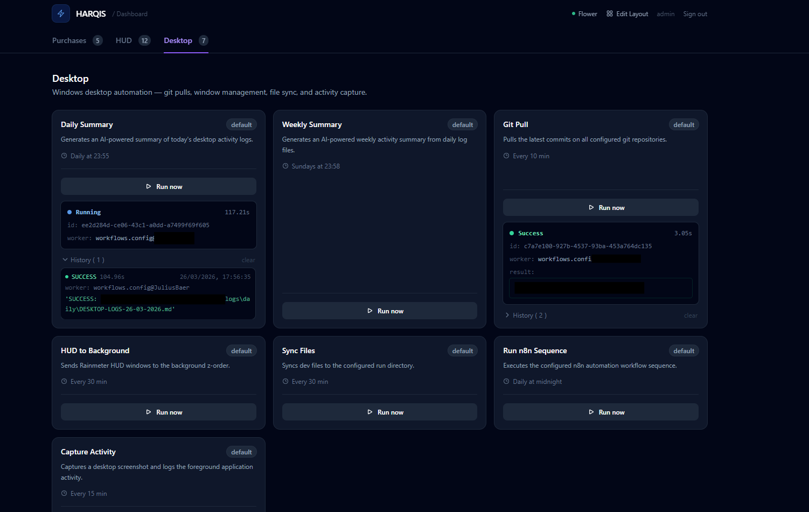

# Dashboard and operations

[Overview](../../README.md) · [Documentation index](README.md)

## Frontend Dashboard

A lightweight, login-protected module frontend for the manifesto, workflow
operations, application inventory and tests, the searchable HFL corpus, and
temporary scope-limited corpus sharing.



> Full setup: [`frontend/README.md`](../../frontend/README.md)

Sharing a workspace? See the [Workspace sharing user guide](WORKSPACE-SHARING-GUIDE.md)
for QR generation, access limits, expiry, and updating or revoking shared content.

For a personal touch, use [entity templates](WORKSPACE-SHARING-GUIDE.md#personalize-a-share-with-one-entity)
to combine selected entities, add optional workspace ideas and other context, then review
and generate a regular or Instant Share.

Use **Organize → Spaces** to manage saved filters, colors, and weekly schedules;
see the [Spaces guide](SPACES-GUIDE.md). **Organize → Facets** manages
personal context you can explicitly select for shared conversations; see
[Facets, Soul, and Spaces](ROLES-AND-SPACES.md).

**Features:** Home manifesto · context-aware Second Brain feed and mode overrides · reorderable workflow and app layouts · one-click task triggering · live HTMX status polling · app documentation and controlled pytest runs · recursive HFL browsing, tag cloud, date search, authenticated canonical-host reads, and signed reference downloads · immutable source-scoped guest portals with QR/PIN access and cited Q&A · Flower link

```sh
cd frontend && python main.py
# → http://localhost:8080
```

---

## Running Tests

```sh
# All tests (excludes workflows/)
pytest

# Kanban agent tests only (offline, no API needed)
pytest agents/projects/tests/ -m "not integration"

# Specific app
pytest apps/echo_mtg/tests/

# By marker
pytest -m smoke
pytest -m sanity
```

App suites contain both offline regression tests (including mocks) and live
integration tests. Live tests require valid credentials and may have side effects;
inspect the target suite before running it. The `integration` marker excludes
marked live tests, but is not a universal offline guarantee across all app suites.
For Kanban tests, use the `-m "not integration"` selection shown above.

---

## Running Services

### Kanban Orchestrator

```sh
python -m agents.projects.orchestrator.local
```

### Celery Workers

```sh
# Worker + Beat (development)
celery -A workflows.config worker --beat --loglevel=info -Q hud,default,tcg

# Worker only
celery -A workflows.config worker --loglevel=info

# Beat scheduler only
celery -A workflows.config beat --loglevel=info
```

### Frontend Dashboard

```sh
cd frontend && python main.py
# → http://localhost:8080
```

### HFL Activity Corpus API

```sh
python scripts/launch.py hfl-api
# → health: http://localhost:8082/health
# → Swagger: http://localhost:8082/docs
```

The daemon is enabled only for machine profiles with `hfl_api = true`; the
canonical `harqis-server` profile is the sole writable API authority.

### MCP Server

```sh
python mcp/server.py
```

---

## Mapping Files

Lightweight JSON-like files exposing Celery tasks and shell commands to n8n and AI orchestrators:

```text
{
    'run-job--example_task': {
        'task': 'workflows.module.tasks.example_task',
        'schedule': <crontab: */10 * * * *>,
        'args': ['PARAM'],
        'kwargs': {}
    },
    'command-run--open_notepad': { 'cmd': 'notepad' }
}
```

- `workflows.mapping` — auto-generated by a Celery management job (**do not edit**)
- `scripts.mapping` — manually maintained shell command bindings

---

## Known Issues

- Worker functions in `tcg_mp_selling.py` re-import dependencies inside the function body — required for `multiprocessing` on Windows (no `fork`)
- `own_tracks` requires the Docker stack running (`docker compose up -d mosquitto recorder` from the repository root) before tests pass
- `moo` app is a hollow stub with no services or tests
- `aaa` tests use `unittest.TestCase` (not pytest-style), placed in `unit_tests.py`
- `google_apps` Keep tests are permanently skipped — `googleapis.com/auth/keep` scope not available for third-party OAuth apps

---
