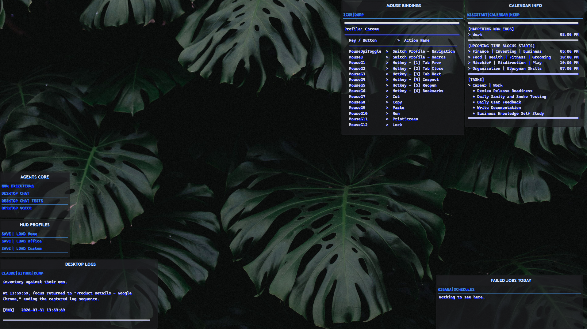

# Workflow and HUD reference

[Overview](../../README.md) · [Documentation index](README.md)

## Workflows

Celery-based scheduled automation. Tasks are registered with `@SPROUT.task` and run on a Beat schedule defined in `workflows/config.py`.

### Workflow Inventory

| Workflow | Status | Celery task entry points | Description |
|----------|--------|-------|-------------|
| `hud` | Active | 24 | Calendar, forex, TCG orders, AI log analysis, YNAB budgets, Rainmeter skins, host fallbacks, and manual compatibility tasks |
| `purchases` | Active | 8 | MTG card resale pipeline: Scryfall bulk → card matching → listings → pricing → audit |
| `desktop` | Active | 8 | Git pulls, window management, file sync, activity capture, daily/weekly summaries |
| `hfl` | Active | 42 | Homework-for-Life capture/ingest → canonical Activity Corpus + Elasticsearch, including fleet observation, GitHub PR review actions, granular note changes, durable outbox replay, and an evidence-grounded activity watchdog |
| `files` | Opt-in | 3 | Source discovery, versioned Drive package publication, and expiry; enabled with `FILES_ENABLED=1` |
| `git_forks` | Active | 1 | Weekly hybrid discovery and drift analysis for harqis-work forks, with one HFL entry per fork instance plus a fleet summary |
| `notes` | Active | 2 | Repository-backed note sync: editing-machine push → canonical host fast-forward pull; HFL performs the downstream ingest |
| `knowledge` | Guarded active | 12 | Multi-source RAG ingest, cited answers, cross-link reports, on-demand topic mapping/scanning, and corpus entity processing |
| `dumps` | Active | 3 | Daily dump collection — fanout per-node ship + harqis-server pull (Android/Termux) → analysis |
| `social` | Active | 1 | Monthly LinkedIn post — git history → Claude → LinkedIn draft + Gmail notification |
| `tcg` | Manual | 6 | Pokedex proxy-printing pipeline (MPC) — manual/pytest-triggered, ships an empty Beat dict |
| `testing` | Hybrid | 2 | Hermes/manual-dispatched test farm generation plus Celery Beat report delivery |
| `second_brain` | Hybrid | 2 | Context-aware advisory feed with deterministic overrides, optional Hermes interpretation, and web/Telegram/Rainmeter/CLI adapters |
| `workers` | Active | 1 | Worker-pool fanout — each worker reports its own location to the `harqis-worker-locations` ES index |
| `mobile` | On-demand | 14 | Android SDK/AVD/device/scrcpy Celery controls; also includes a standalone Termux screen logger |
| `finance` | Manual | 1 | Parse bank-statement PDFs and import categorized transactions into YNAB |
| `n8n` | Utilities | 0 | Shell utilities and ngrok helpers for n8n integration |

### Celery Task Queues

Declared in `workflows/queues.py` (`WorkflowQueue` enum) and registered with RabbitMQ in `workflows/config.py` (`SPROUT.conf.task_queues`). Workers consume specific queues based on each machine's `queues = […]` list in `machines.toml`.

**Direct (competing-consumers)** — exactly one worker handles each published task:

| Queue | Used by |
|-------|---------|
| `default` | Catch-all / unrouted tasks; fallback when a task has no `options.queue` |
| `files` | Catalog scans, package publishing and expiry on the catalog server only |
| `hud` | Windows desktop collectors and existing TCG fulfillment; portable HUD collectors and broadcasts use more-specific routes |
| `peon` | Work-context HUD tasks (Jira boards, calendar focus, etc.) |
| `tcg` | TCG marketplace pipeline — Scryfall bulk, card matching, listings, pricing |
| `adhoc` | One-off / manual triggers (no schedule) |
| `host` | Tasks that must run on the host (Docker, broker access), including portable HUD Calendar/finance/Jira/radar/job-summary collectors and `workflows.second_brain.tasks.*` |
| `agent` | AI agent task dispatch (Kanban / Hermes worker invocations) |
| `worker` | Generic background worker pool (cross-app jobs) |
| `n8n` | n8n container ops (backup / restore / deploy) — pinned to `harqis-server` |
| `hfl` | Homework-for-Life capture / ingest / summarize / recall — pinned to `harqis-server` |
| `capture` | Isolated Windows desktop screen-reader supervisor; consumed only by `capture-worker` |

**Broadcast (fanout)** — every subscribed worker runs each task; tasks **must** be idempotent. A worker only receives broadcasts when its `queues` list includes the broadcast name. Beat and workers pre-declare the fanout exchanges at startup in `workflows/config.py`, preventing missing-exchange `NOT_FOUND` failures before consumers subscribe; this does not retain broadcasts for workers that are not subscribed.

| Queue | Used by |
|-------|---------|
| `default_broadcast` | Cluster-wide jobs that every node must run locally — e.g. `git_pull_on_paths` so each node refreshes its own working tree |
| `hud_broadcast` | HUD-level fanout — `workflows.hud.tasks.broadcast_*` (auto-routed); reload skin config / refresh-all-HUDs cluster-wide |
| `workers_broadcast` | Worker-pool-wide fanout — e.g. `broadcast_report_location` so every worker reports its own location |
| `agents_broadcast` | Agent-pool-wide control messages (declared in enum; reserved) |
| `hfl_broadcast` | HFL ingest fanout and durable outbox replay — each worker captures/flushes its own local signal |

> Routing override: a task can target any queue via `options={"queue": WorkflowQueue.X}` in its Beat schedule entry, regardless of `task_routes` patterns.
>
> Optional OS hint: beat entries may also include `options={"os": ["windows"]}` (or `["macos", "linux"]`, etc.) — informational only; consumed by the `/manage-queues` skill to surface OS-vs-routing mismatches. Celery does not enforce this field.

### Beat schedule

```python
# workflows/config.py
CONFIG_DICTIONARY = (
    WORKFLOW_PURCHASES | WORKFLOWS_HUD | WORKFLOWS_DESKTOP | WORKFLOW_SOCIAL
    | WORKFLOW_KNOWLEDGE | WORKFLOW_DUMPS | WORKFLOW_HFL | WORKFLOW_NOTES
    | WORKFLOW_WORKERS
    | WORKFLOW_TESTING | WORKFLOW_TCG
    | WORKFLOW_GIT_FORKS | WORKFLOW_SECOND_BRAIN | WORKFLOW_FILES
)
SPROUT.conf.beat_schedule = _celery_safe_schedule(CONFIG_DICTIONARY)
```

### Task decorator pattern

```python

@log_result()           # Logs output to Elasticsearch
@init_meter(...)        # Initializes Rainmeter desktop widget
@feed()                 # Pushes data to desktop HUD feed
def show_calendar_information(**kwargs):
    ...
```

---

## Desktop HUD

**Express → Second Brain** opens the agent fleet workspace at `/agents`. Use the highlighted brain icon at the start of its toolbar to open the full **Second Brain web dashboard** at `/second-brain`; the dashboard robot icon returns to the workspace. The two views keep independent layouts and controls while sharing saved Space selection and widget Space membership. The dashboard supports persistent layouts, Space-aware visibility, eight snap sizes, mobile stacking, motion, monitoring and agent-assisted creation. See the [migration review and Second Brain refresher](SECOND-BRAIN-HUD-MIGRATION.md) and [complete source inventory](HUD-SOURCE-INVENTORY.md).

Rainmeter rendering is deprecated and opt-in (`HARQIS_LEGACY_RAINMETER=1`). Existing source tasks and dumps continue; the desktop behavior described below applies when legacy rendering is enabled.

HARQIS drives a live desktop heads-up display using [Rainmeter](https://www.rainmeter.net/) on Windows. Celery tasks in `workflows/hud/` push data from connected services into Rainmeter skin files.

> **Offline resilience:** Portable Calendar, finance, Jira, radar, and job-summary collectors run on the `host` queue; Windows-specific collectors use `hud` or `peon`, and TCG fulfillment remains on `hud` (see `workflows/config.py` and `workflows/hud/tasks_config.py`). The legacy radar **data-only fallback twin** in `workflows/hud/tasks/hud_data_only.py` is heartbeat-gated. Prefer the portable collectors for current Second Brain panels. See [`workflows/hud/README.md`](../../workflows/hud/README.md#data-only-fallback-host).



### Calendar-driven visibility

**The HUD is wired with Google Calendar.** Each widget carries a `ScheduleCategory`; Rainmeter only renders widgets whose category matches the **current calendar event's name**. Block `"Finance | Investing | Business"` and the finance widgets surface; switch to `"Career | Work"` and the Jira board takes over. The dashboard reshapes itself across the day, no manual toggling.

| Category | Calendar event name | Widgets that surface |
|---|---|---|
| `PINNED` | (always visible — no event needed) | Calendar Info, Desktop Logs, HUD Profiles, Agents Core, Failed Jobs, Hermes Radar, Second Brain |
| `WORK` | `"Career \| Work"` | Jira Board |
| `FINANCE` | `"Finance \| Investing \| Business"` | OANDA Account, PC Daily Sales, API Costs |
| `PLAY` | `"Mischief \| Misdirection \| Play"` | TCG Orders, TCG Sell Cart |
| `ORGANIZE` | `"Organization \| Everyman Skills"` | Budgeting Info, PC Daily Sales, API Costs, Mouse Bindings (also `WORK`) |
| `DEACTIVATED` | — | Never auto-shows; manual trigger only |

Widgets are wired to categories in each task's `@init_meter(..., schedule_categories=[ScheduleCategory.<X>])` decorator. A widget can list multiple categories (e.g. `Mouse Bindings` is both `ORGANIZE` and `WORK`) so it surfaces during any matching block.

### Panel inventory

| Panel | Visibility | Data source | Update frequency |
|-------|-----------|-------------|------------------|
| **Calendar Info** | Always | Google Calendar — today's events and upcoming schedule | Every 15 min |
| **Desktop Logs** | Always | Claude Haiku — AI summary of captured activity screenshots | Hourly at :05 |
| **HUD Profiles** | Always | Rainmeter / iCUE — active HUD profile selector and load/save | Daily at midnight |
| **Agents Core** | Always | n8n + ElevenLabs — chat agent and voice assistant launcher | Daily at midnight |
| **Failed Jobs Today** | Always | Celery — tasks that errored since midnight | Every 15 min |
| **OANDA Account** | Finance block | OANDA — forex account NAV and open trades | Every 15 min (Mon–Fri) |
| **PC Daily Sales** | Finance + Organize blocks | AppSheet `INVOICE` table — gross daily sales grouped by month, last 60 days, scrollable | Every 2 hours |
| **Budgeting Info** | Organize block | YNAB — budget balances in PHP and SGD with overspend warnings | Every hour |
| **API Costs** | Finance + Organize blocks | Anthropic admin usage API (OpenAI / Gemini stubbed) — trailing 3-month LLM spend grouped per month → service → model | Every 30 min |
| **Jira Board** | Work block | Jira Software — In-Review / In-Progress / Ready / In-Analysis tickets | Weekdays every hour |
| **Hermes Radar** | Always | Sanitized Hermes Telegram pushes from the last 12h (no item cap) above the established Claude Haiku productivity synthesis, which retains an 8h analysis window. The host exports an atomic shared JSON snapshot and refreshes the portable projection; Windows never opens Hermes state or polls Telegram. The Rainmeter folder/task IDs remain `DAILYRADAR` / `show_daily_radar` for compatibility. | Push snapshot hourly at :00; HUD refresh hourly at :05; synthesis at 08:00, 12:00, 16:00, 20:00 |
| **Second Brain** | Always when enabled | Canonical redacted advisory feed | Dispatched by reconciliation (every 15 min) when Rainmeter delivery is enabled |
| **Mouse Bindings** | Organize + Work | iCUE Corsair Scimitar — active macro bindings for the foreground app | Every 60 sec |
| **TCG Orders** | Play block | TCG Marketplace — open and pending orders with card art | Every hour |
| **TCG Sell Cart** | Play block | TCG Marketplace — match listings to active want-to-buy bids | Fri–Sun at 01:00, 08:00, 12:00, 20:00 |

---
