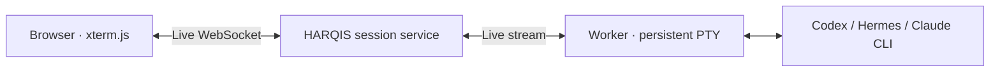

# Browser CLI agent sessions for HARQIS

Date: 2026-11-18

Status: Investigation and proposed direction; no runtime changes implemented.

## Question and conclusion

A screenshot of an interactive CLI in a Coder browser terminal prompted the
question: could HARQIS provide the same experience for Codex, Hermes, or Claude,
and why does it appear faster than the current Kanban agent session?

Yes. HARQIS already has much of the foundation: xterm.js in the browser and a
real pseudo-terminal (PTY) on the worker. The main proposed improvement is
replacing polling on both sides with persistent streaming connections, then
adding CLI runtime adapters. Installing the entire Coder platform is not
necessary to implement this architecture.

## How the screenshot's terminal works

The screenshot's browser title and URL identify Coder's web terminal. The CLI
runs in the remote workspace. Its text, colours, cursor movements, and interactive
controls are rendered in the browser by xterm.js; the browser is not displaying
a video stream of a desktop.

Coder documents the following architecture:

1. The browser renders the terminal using xterm.js.
2. A persistent WebSocket transports terminal input and output.
3. The control plane routes traffic to the workspace agent.
4. The workspace agent manages a PTY connected to the shell process.
5. The CLI runs within that terminal environment.

Coder uses reconnection tokens and buffers output during disconnections. The
shell can continue running when the browser closes, allowing reconnection to
the same session. Session continuity still depends on the workspace process
remaining alive.

Source: [Coder web terminal architecture and persistence](https://coder.com/docs/user-guides/workspace-access/web-terminal#architecture),
consulted 2026-11-18. This identifies the documented architecture; the private
deployment shown in the screenshot was not inspected directly.

## Existing HARQIS implementation

The repository inspection found the following behavior in the action-linked
interactive terminal, rather than assuming all Kanban execution paths are the
same.

| Component | Current implementation |
| --- | --- |
| Browser renderer | xterm.js with a fit addon |
| Actual terminal | Worker-side PTY, with Windows and POSIX implementations |
| Browser output delivery | HTTP polling after 75 ms when active or 400 ms when idle, plus request duration |
| Worker input/output | Polling loop with 50-250 ms intervals, plus request duration |
| New terminal discovery | Worker checks for queued terminal sessions every 2 seconds |
| Interactive runtime | Hermes; Codex and Claude are unavailable in the application-development action-session adapter |
| Session integration | Existing configuration, capacity, expiry, transcripts, artifacts, and isolated workspace handling |

Source files, relative to the repository root:

- [Browser terminal](../../frontend/static/js/action-agent-workspace.js):
  `poll()`, `terminal.onData`, terminal construction, resize handling, and session attachment.
- [Terminal worker](../../scripts/agents/hfl/action_terminal.py):
  PTY implementations, `TerminalWorker`, polling, and `watch_terminals`.
- [Session routes](../../frontend/modules/hfl_corpus/action_agents.py):
  browser input/output endpoints and worker poll/output endpoints.
- [Session store](../../workflows/hfl/action_agent_store.py):
  durable session state and input/output storage.
- [Runtime registration](../../frontend/modules/integrations/agents.py):
  Hermes adapter availability and unavailable Codex/Claude placeholders.
- [Codex observation transport](../../frontend/modules/integrations/codex_transport.py):
  an existing read-only app-server integration, not an interactive CLI launcher.

These are findings from the local checkout on the investigation date, not a
verification of which revision is deployed on every HARQIS host.

## Why the browser terminal can feel faster

The current HARQIS path includes separate browser and worker polling stages.
Input waits to reach the worker, and output waits to reach the browser. These
delays can compound, in addition to network round trips, request processing,
storage, and any capacity wait. The polling periods above are not a measured
end-to-end latency or a guaranteed delay for every keystroke.

A persistent stream can deliver keystrokes and output as they become available,
which should make typing, cursor updates, and incremental responses smoother.
Changing only the browser connection would leave the worker polling delay.

This is a plausible explanation for the perceived difference, not a benchmark
result. No live latency comparison was performed. A smoother terminal does not
make the underlying model reason faster; model choice, provider latency, context,
tool execution, startup, and queue capacity can still dominate response time.

## Proposed HARQIS architecture

The worker owns the CLI process independently of the browser connection. HARQIS
keeps session identity and card associations while relaying interactive input,
output, and terminal resize events.

Recommended implementation sequence:

1. Upgrade the existing Hermes terminal to end-to-end WebSocket streaming,
   covering both browser-to-service and service-to-worker transport.
2. Preserve the CLI process across browser disconnects, with bounded output
   replay when the user reconnects.
3. Add Codex and Claude runtime launch adapters, reusing terminal rendering,
   workspace selection, resizing, and session lifecycle controls. Each runtime's
   installed CLI, authentication, and launch/resume behavior needs verification
   during implementation; the current placeholders do not provide this support.
4. Preserve Kanban integration: launch from a card, provide its context, and
   attach transcripts and generated artifacts. Persist those asynchronously so
   persistence does not hold up live terminal output.

Existing session authentication, ownership checks, capacity rules, expiry, and
workspace isolation need to carry over to the streaming implementation.

## Proposed user experience

Add an **Open live CLI** option on a Kanban card, with a runtime selector for
available Hermes, Codex, and Claude installations and a full-page terminal.
Kanban manages the work and its outputs; the terminal provides immediate
interaction with the selected CLI. Reopening the session should reconnect to
the running process where it is still available.

This is an extension of the existing HARQIS implementation. The investigation
does not authorize or claim a completed runtime implementation, deployment,
performance benchmark, or migration of existing sessions.
