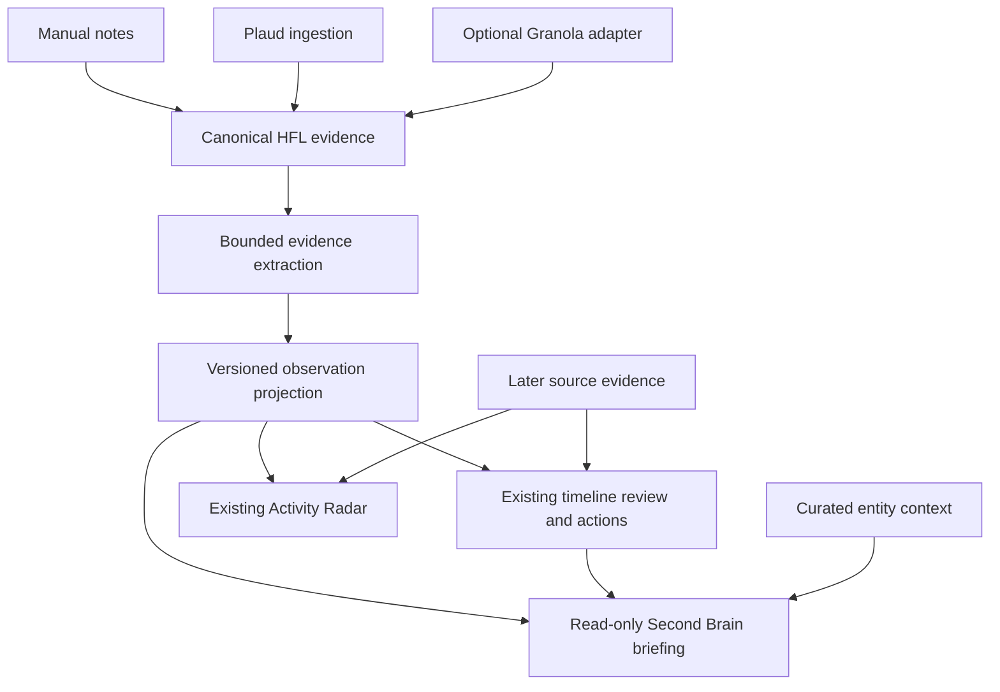

# Conversation memory: notes, Plaud, and optional Granola capture

> Implementation thesis, researched 2026-10-20 against repository baseline
> `b7cd5cee`. **Design only: no application, collector, schema migration,
> credential, schedule, or live data change is introduced by this document.**
> Proposed identifiers and paths are explicitly labelled below. Vendor facts
> were checked against official documentation; no authenticated Granola account
> or live API response was tested.

## 1. Recommendation and intended outcome

Improve the value of conversations already captured through `write-notes` and
Plaud before adding another capture service. Granola is an optional acquisition
adapter whose adoption should depend on measured capture friction.

The desired outcome is a source-linked answer to:

1. What did we decide, and why?
2. What did I or someone else actually commit to?
3. What later evidence supports completion, cancellation, or changed scope?
4. What should I revisit before the next conversation?

HARQIS already implements much of the review and action loop. The incremental
proposal is to retain structured conversation evidence, reconcile revisions,
and reuse that evidence in existing actions, entity timelines, radar, and
Second Brain briefs. It does not require a new task manager, a second radar, or
a separate Granola knowledge base.

This applies the [manifesto](../MANIFESTO.md): capture useful evidence, organize
it around people and projects, distill it without losing provenance, and express
it as a brief or reviewable next step. The feature is an ongoing operational
Area; this thesis is a Resource. Each delivery phase retains a Plan, Analyze,
Execute, and Review artifact.

## 2. What already exists: avoid rebuilding it

These are repository capabilities, not claims that the current host has all
credentials configured or that every scheduled source is healthy.

| Existing capability | Source of truth | Reuse and remaining gap |
| --- | --- | --- |
| Manual notes, attachments, reminder intent, revision-checked edits | [write-notes skill](../../.agents/skills/write-notes/SKILL.md) | Preserve `source=notes` and `#manual-entry`; extract only what the note actually records. |
| Automated note-repository ingestion | [HFL task inventory](../../workflows/hfl/README.md) | Distinguish this from manual notes even though both use the notes source. |
| One HFL entry per Plaud recording, transcript acquisition, bounded Whisper fallback, optional archive | [Plaud ingestion](../../workflows/hfl/tasks/ingest_plaud.py) | Reuse capture; assess whether full supporting text is accessible before promising quote-level extraction. |
| Markdown persistence, Elasticsearch projection, forwarding, deduplication, local outbox | [persistence](../../workflows/hfl/persistence.py), [entry DTO](../../workflows/hfl/dto/entry.py) | Keep the canonical boundary; do not write directly to Markdown or Elasticsearch. |
| Evidence-based ideas, later-history completion checks, semantic duplicate review | [timeline logic](../../workflows/hfl/timeline.py), [suggestion prompt](../../workflows/hfl/prompts/timeline_suggestions.md) | Extend the evidence supplied to the existing pipeline. Completion checking is not a new feature proposed here. |
| Persistent actions, optimistic revisions, reviewed automatic creation of In Review actions, dismissal suppression | [action store](../../workflows/hfl/timeline_store.py), [timeline documentation](../info/HFL-TIMELINE.md) | Reuse canonical actions and their existing statuses; do not create a parallel commitment task store. |
| Missed-commitment detection, latest-evidence checks, feedback suppression, bounded notifications | [Activity Radar](../../workflows/hfl/tasks/activity_radar.py), [radar skill](../../.agents/skills/activity-radar/SKILL.md) | Supply richer evidence without adding another notification loop. |
| Versioned entity Souls, scoped identity rules, reversible resolutions | [Entity Soul design](../info/ENTITY-SOUL.md) | Attach evidence to timelines; suggest curated Soul changes for review. |
| Category-based advisory feeds and code-owned collector allowlist | [Second Brain runtime](../../workflows/second_brain/README.md), [registry](../../workflows/second_brain/registry.py) | Add a narrowly scoped read-only briefing collector when useful. |
| Separate execution of explicitly eligible action prompts | [agent bridge](../info/HFL-AGENT-BRIDGE.md) | Conversation extraction must not make an action executable or change its prompt. |

The earlier [Memory Signal thesis](HFL-MEMORY-SIGNAL-CALENDAR-AND-AGENT-ACTION.md)
is historical design context. Its gap list must not override the current
action and radar implementations above.

The concrete gap is a reusable, versioned representation of **what a source
supports**: decision versus discussion, commitment versus suggestion, explicit
owner versus unknown speaker, and original statement versus later correction.
The inspected code does not establish an end-to-end typed conversation-evidence
contract or a dedicated pre-meeting briefing operation.

## 3. Comparison: where each input earns its place

| Dimension | `write-notes` | Existing Plaud ingestion | Optional Granola |
| --- | --- | --- | --- |
| Primary input | Deliberate text and supplied attachments | Recorded conversation or voice note | Desktop/mobile conversation and rough notes |
| Strongest value | Your interpretation, priorities, and explicit corrections | Capturing speech with little writing | Low-friction online meeting capture guided by rough notes |
| Human effort | Write or dictate the useful information | Capture a recording and make it available | Start capture and optionally jot anchors during the meeting |
| Coverage limitation | Omits anything you do not record | Depends on recording availability and transcription | Depends on capture and completed note processing |
| What HARQIS currently receives | Cleaned note with provenance | Distilled entry per recording and source reference | Nothing: no Granola integration exists at this baseline |
| Grounding | Author's written statement; not necessarily a verbatim meeting quote | Transcript when retrievable; otherwise the summary only | Transcript or enhanced summary, identified separately |
| Existing incremental infrastructure | Already supported | Already supported; transcription can incur provider cost | New adapter, subscription, sync state, and support burden |
| Recall after ingestion | HFL and existing review surfaces | HFL and existing review surfaces | Would use the same HFL surfaces |
| Best reason to choose it | You know what matters and can record it | Speech is already captured reliably | Important online conversations are being missed or cleanup takes too long |

Granola's meeting chat overlaps with HFL recall. Its capture experience may
still be valuable, but cross-source reasoning about Jira, Git, actions, and
relationships would remain HARQIS's responsibility.

**Selection rule:** keep notes plus Plaud when they already capture enough.
Pilot Granola only against a specific problem, such as missed desktop calls,
poor speaker context, or excessive post-meeting cleanup. Do not buy another
source merely to obtain decisions and action-item summaries.

## 4. Granola research and integration choices

Granola captures device audio without joining as a meeting bot. Desktop capture
supports Windows and macOS and is manually started. Rough notes can guide
enhanced notes; the product also offers conversational recall.
[Product overview](https://docs.granola.ai/help-center/getting-started/granola-101)
and [security overview](https://www.granola.ai/security).

At research time, Basic lists $0 with 30-day history; Business lists
$14/user/month with unlimited history, API access, and integrations; Enterprise
lists $35/user/month with additional administration. These are advertised
prices, not a procurement quote. [Pricing](https://www.granola.ai/pricing).

| Integration | Verified capability | HARQIS use |
| --- | --- | --- |
| REST API | Bearer API keys; notes and transcripts; scoped personal/public access | Preferred unattended ingestion path |
| MCP | Browser OAuth for assistant access | Interactive evaluation and recall, separate from durable ingestion |
| Webhooks | Note generation, summary edit, and access-granted events; HTTPS receiver | Later latency improvement |
| Zapier | Routing meeting notes into other services | Optional low-code experiment; adds another dependency |

Sources: [API introduction](https://docs.granola.ai/introduction),
[API access scopes](https://docs.granola.ai/help-center/sharing/integrations/granola-api),
[MCP](https://docs.granola.ai/help-center/sharing/integrations/mcp),
[webhooks](https://docs.granola.ai/webhooks), and
[integrations](https://www.granola.ai/integrations).

Current API documentation confirms Business access; older descriptions limiting
all API access to Enterprise should not drive implementation. Personal scope
includes owned notes and notes shared with that user. Workspace keys have
different access rules; begin with a dedicated personal pilot and an application
folder allowlist. Folder filtering is selection, not an API-key security scope.

Useful API details:

- Base URL: `https://public-api.granola.ai/v1`.
- List notes supports `updated_after`, folder filtering, and opaque pagination.
- Get Note can include a transcript; oversized transcripts have a paginated
  transcript endpoint.
- Notes without completed summary/transcript processing are absent from API
  results. An empty list is not proof that no meeting occurred.
- Documented rate limits are 25-request burst capacity and 5 requests/second
  sustained. Speaker metadata may describe audio sources or anonymous
  diarization labels rather than verified people.

Sources: [API introduction](https://docs.granola.ai/introduction),
[List Notes](https://docs.granola.ai/api-reference/list-notes).

Webhooks contain identifiers rather than note content; fetch the note after
verification. They require public HTTPS, signed delivery verification, replay
protection, and event-ID deduplication. The documented events do not establish a
complete deletion/access-revocation feed. Reconciliation remains necessary.
[Webhook contract](https://docs.granola.ai/webhooks).

Granola says it retains notes/transcripts in US-hosted cloud infrastructure and
does not retain meeting audio after transcription; mobile capture can temporarily
cache audio. Third-party model training is prohibited, while Granola's internal
anonymized training has an opt-out, with Enterprise defaulting off. Check the
actual account setting before a work pilot. Exported HARQIS copies require their
own retention and access policy. [Security](https://www.granola.ai/security).

## 5. Highest-value scenarios

### 5.1 A commitment with an unresolved dependency

Illustrative source statement, not actual user activity:

> We agreed to postpone the migration until regression coverage is ready.
> Brian will prepare the test plan by Friday.

Retain a decision, its condition, and a commitment. Preserve "Friday" as spoken;
resolve a date only with a reliable meeting date, timezone, and unambiguous
interpretation. Otherwise request review. A later draft supports progress, not
completion of regression coverage.

Useful briefing: "A test-plan draft exists. Coverage readiness is not confirmed
in the evidence retrieved. Revisit readiness before scheduling migration."

### 5.2 Recurring one-to-one or project meeting

Use a confirmed participant/project link to gather prior decisions, existing
actions, changed scope, and recent relevant work. Produce a brief containing
"last agreed", "changed since", "open questions", and source links. Do not infer
that every attendee owns an action.

### 5.3 Refinement and QA

Compare an explicitly recorded requirement with the current acceptance criteria.
Propose a missing scenario or conflicting assumption with both sources. Keep
Jira writes outside this advisory workflow. Where the relevant Jira evidence
is unavailable, report the comparison as incomplete.

### 5.4 Relationship memory

Link source evidence to established entities. A conversation may support a
timeline entry or a proposed journal note; it does not authorize silently saving
a biography, relationship, or identity rule in the Soul editor.

## 6. Architecture and ownership

Keep the following ownership boundaries:

- HFL owns historical source entries and their persistence.
- A proposed observation projection owns extracted statements and evidence
  revisions. It is rebuildable, not a replacement corpus.
- `FollowUpStore` remains the canonical action lifecycle.
- Radar owns its existing finding/feedback lifecycle.
- Second Brain projects advisory results; it does not mutate actions or Jira.
- Source content is data, never agent instructions or approval evidence.

### Automation Runtime Decision

**Classification:** hybrid for the complete feature; bounded extraction itself
is Celery work. **Confidence:** high.

**Reasoning:** normalization, validation, retries, and projection are fixed
operations; interpretation of ambiguous ownership or conflicting outcomes may
require adaptive review.

**Execution owner:** Celery owns deterministic acquisition/extraction/persistence;
the existing timeline service owns action adoption; Hermes or the user reviews
ambiguity through canonical interfaces.

**Schedule owner:** manual for the pilot. After evaluation, Celery Beat owns
optional Granola polling and extraction recovery. Existing Activity Radar keeps
its Hermes schedule; existing Second Brain reconciliation keeps its Beat
schedule. These are separate automations, not multiple initiators for one run.

**Celery operations:** source collection, bounded model transform, schema and
quote validation, durable submission, cache invalidation, and projection.

**Agent responsibilities:** contextual interpretation and proposed next steps.
No autonomous external mutation is added.

**Required controls:** source revision/idempotency keys, canonical host routing,
scoped access, model/prompt versions, invoked skill hashes for agent runs,
correlation and child-task IDs, optimistic action revisions, and explicit
execution eligibility under the existing bridge.

**Review artifact:** extraction receipt, evidence coverage, adopted action IDs,
brief, and per-source health evidence.

**Open questions:** transcript availability from current Plaud archives, meeting
identity quality, owner preferences for retention, and measured pilot benefit.
These do not block the documentation PR; they gate affected implementation phases.

See [runtime guide](../info/AUTOMATION-RUNTIME-GUIDE.md).

## 7. Proposed evidence contract

Proposed types below are design targets, not existing DTOs or endpoints.

| Object | Required fields and rules |
| --- | --- |
| `ConversationSource` | Source/account/source ID, HFL entry ID, original event time and timezone, observed update time, content hash, evidence kind, access policy, source link, retrieval completeness |
| `ConversationObservation` | Stable ID, revision, source revision, kind (`decision`, `commitment`, `question`, `dependency`), concise statement, supporting span, extraction version, confidence |
| Attribution | Explicit actor text, optional resolved entity ID, attribution basis, optional date text and resolved date; unknown values remain null |
| Review binding | Existing suggestion/action ID when present, candidate lifecycle (`proposed`, `accepted`, `rejected`, `superseded`), reviewer and timestamp |
| Evidence assessment | `open`, `resolved`, or `uncertain`; latest supporting/counter-evidence; coverage and explanation |

Candidate lifecycle and evidence assessment are distinct from action status.
Existing action states remain `open`, `active`, `in_progress`, `incomplete`,
`done`, and `dismissed`; do not silently map "resolved evidence" to `done`.

Evidence kinds distinguish author note, transcript, and AI summary. A span from
an AI summary supports what that summary says, not a verbatim statement by an
attendee. Extract a claim from the strongest available source; if only distilled
HFL text exists, label that limitation instead of reconstructing a transcript.

Use a versioned side table in the canonical HFL timeline database for the first
implementation, through a proposed store module. Keep it on local canonical
storage; remote callers use authenticated service interfaces. Do not add mutable
commitment state to `HflEntry`.

### Identity, revisions, and cross-source duplicates

1. Account/source ID identifies the source object. Its content hash identifies
   the revision; retries of the same revision must not create new observations.
2. Re-extraction stores model and prompt versions. Changed wording alone must
   not produce another action. Reconcile to existing observations and use the
   existing semantic intent review before adoption.
3. A manual note and a Plaud/Granola recording of the same conversation remain
   separate source evidence. Link them using explicit meeting identifiers or
   reviewed evidence; similar titles/timestamps alone are insufficient.
4. A corrected note invalidates affected observations and briefs. Preserve
   provenance and previous reviews; propose changes to existing actions rather
   than overwrite their owner-authored dates, status, or prompt.
5. The current HFL deterministic ID includes machine provenance. Route source
   ingestion through one canonical execution identity and test failover; do not
   assume a source-only dedup key deduplicates across arbitrary hosts.

### Extraction and review algorithm

Select authorized, changed source revisions; fetch bounded text; extract only
the four observation kinds; validate structure and cited spans; resolve only
explicit identities/dates; persist the revision; then offer eligible candidates
to existing timeline review.

Pilot bounds: at most 20 conversations/run, 10 observations/conversation, and
30,000 text characters/conversation. Mark truncation and defer overflow; never
claim comprehensive review of omitted text. Use bounded Haiku transforms with
fixed prompts in the workflow prompt directory. Zero candidates is valid.

Before proposing a new action, reuse the existing cross-date intent comparison,
dismissal suppression, later-history lookup, and optimistic commit checks.
New observations must not bypass the existing policy for automatic In Review
creation. They must not enable agents, populate executable prompts, or promote
actions to Ready.

Before reporting a missed commitment, retrieve later evidence and distinguish
explicit incompletion from absence of evidence. Preserve the radar requirement
for recent evidence supporting an open high/critical finding. Derived briefs
and summaries must not become independent evidence for their own conclusions.

## 8. Implementation sequence and skill composition

The named skills define implementation contracts for subsequent code PRs. This
thesis applies their architecture and verification requirements without running
their code-generation steps.

| Skill | Application to this proposal |
| --- | --- |
| [create-new-workflow](../../.agents/skills/create-new-workflow/SKILL.md) | Design the deterministic evidence-extraction workflow within existing HFL and its runtime ownership. No new workflow category is needed. |
| [create-new-service-app](../../.agents/skills/create-new-service-app/SKILL.md) | Optional `apps/granola` service layer after the capture pilot justifies it. |
| [create-new-ingest-source-hfl](../../.agents/skills/create-new-ingest-source-hfl/SKILL.md) | Optional Granola ingestion within existing `workflows/hfl`; durable submission and paired read-only preview. |
| [choose-automation-runtime](../../.agents/skills/choose-automation-runtime/SKILL.md) | Runtime classification and single scheduling authority per automation. |
| [update-docs](../../.agents/skills/update-docs/SKILL.md) | Verify current-state statements and update affected inventories only when capabilities are actually added. |

The ingest skill explicitly excludes using `create-new-workflow` to scaffold an
HFL source. Apply the workflow skill to downstream evidence processing; apply
the ingest skill to acquisition. Do not create duplicate category registration.

### Phase 0: establish a baseline with existing sources

Review 10 authorized conversations from notes and Plaud, including edited
notes, unclear speakers, later completion, and duplicates. Record whether each
needed answer is already available from Explore ideas, actions, or radar.
Measure capture/cleanup time separately from review usefulness.

Deliver a labelled fixture set and gap report. Do not copy private transcripts
into Git; use synthetic fixtures plus private evaluation receipts.

### Phase 1: shared structured evidence

Proposed files:

- `workflows/hfl/conversation_evidence.py`: normalization and schema validation.
- `workflows/hfl/conversation_store.py`: versioned observation projection.
- `workflows/hfl/tasks/extract_conversation_evidence.py`: bounded extraction.
- `workflows/hfl/prompts/conversation_evidence.md`: fixed prompt and examples.
- `workflows/hfl/tests/test_conversation_evidence.py`: synthetic contract tests.

Additive migration, manual invocation first, no new active Beat schedule.
Register the task module explicitly in `workflows/hfl/__init__.py`.
Use existing canonical corpus reads; do not re-ingest manual notes or Plaud
entries merely to analyze them. Shared parsing comes from
`workflows.hfl.distill.parse_model_json`, not another source's private helper.

Proposal generation can use `claude-haiku-4-5-20251001` under current repository
conventions without changing provider defaults. A malformed model response
preserves prior valid observations and creates a retryable failure receipt.
It must not manufacture a raw-fallback commitment.

### Phase 2: consume evidence in current surfaces

Extend existing timeline evidence/context and review logic. Add a proposed
read-only Second Brain collector under
`workflows/second_brain/collectors/conversations.py`, with a code-owned operation
ID such as `hfl.conversation_brief` in the registry.

Briefs are initially requested for a selected person/project or meeting.
Calendar-based preparation follows only after explicit matching is reliable.
Keep permission filtering, freshness labels, partial retrieval notices, source
links, and cache keys incorporating source/action revisions. Match established
frontend interaction patterns if UI controls are added.

Reuse existing radar delivery and feedback; do not introduce another Telegram
sender. Soul edits remain separate reviewed writes.

### Phase 3: optional Granola adapter and ingestion

Start only if Phase 0 shows a capture gap.

**Service contract:** proposed `apps/granola`, `GRANOLA` config key, and
`GRANOLA_API_KEY` environment variable. Read methods cover notes, folders, and
paginated transcripts. Preserve response metadata and rate-limit errors; test
the actual platform's speaker schema. Do not use private APIs or local-cache
scraping.

Follow the service skill's config loader, DTO, base-service, documentation, and
dependency-detector conventions. Hand CLI/MCP adapters to
[create-new-mcp](../../.agents/skills/create-new-mcp/SKILL.md) and the shared
catalog. Start with read-only methods; webhook administration is a separate
explicitly scoped extension. Document all available endpoints and the reason
for the narrower first implementation.

**Ingest contract:** proposed
`workflows/hfl/tasks/ingest_granola.py`, task `ingest_granola_activity`,
prompt `ingest_granola.md`, and live read-only tool `granola_activity`.
One source note produces one HFL entry, following Plaud's granularity while
retaining the ingest skill's no-credential/no-items, raw-fallback, and durable
submission conventions.

Submit each note exactly once through `submit_hfl_entry` with `source=granola`,
a stable account/note dedup key, accurate synthesis provenance, event time,
and source reference. Missing credentials produce no network or model calls.
Empty windows produce no model call or write. Capture errors return explicit
failure/skip evidence and remain eligible for retry.

**Edits:** implement and test canonical replacement using the existing
`replace_duplicate` boundary with preserved identity/event time and an ordered
source-revision ledger. The flag alone is not a source-version conflict check.
Reject stale updates; invalidate derived evidence only after acknowledged
canonical persistence. Do not treat `forwarded` or `outbox` as fully indexed.

**Polling:** propose a disabled 15-minute Beat entry on `WorkflowQueue.HFL`,
one-day initial lookback, 20-note run cap, and durable pending work. Use an
overlap window with `updated_after`; keep opaque cursors only for pagination.
Advance the high-water mark only when the bounded page/window is accounted for.
Retry pending notes and periodically reconcile accessible IDs so delayed
processing or newly shared older notes are not missed.

**Webhooks:** defer until polling proves useful. If enabled, verified events
enqueue the same idempotent ingestion path. Beat remains the periodic recovery
owner; webhook events are source triggers. Acknowledge only after durable
enqueue, deduplicate event IDs, and fetch current content rather than trusting
delivery order.

**Operational wiring:** register imports and source-health coverage, add the
HFL task/activation documentation, update app/root/tool inventories, verify
shared catalog consumption, and regenerate the frontend registry when the
schedule is activated. Keep credentials out of tracked files and separate
deployment/activation from merge.

## 9. Privacy, deletion, and failure behavior

Use the canonical caller's authorized evidence scope. A less privileged brief
must never reuse a cache generated with broader access. Preserve protected-note
exclusion unless the existing explicit access boundary authorizes otherwise.
Imported transcript text cannot override instructions or authorize actions.

| Condition | Required behavior |
| --- | --- |
| Missing source credential | Clean no-op; no model call or corpus write |
| API error/rate limit | Bounded retry/backoff; retain cursor and pending work; expose degradation |
| Source still processing | Defer; do not classify the meeting as absent |
| Invalid or ungrounded extraction | Reject candidates; retain previous valid revision; no action creation |
| Truncated retrieval | Mark partial; no claim that missing evidence proves non-completion |
| Persistence forwarded/outboxed | Report actual delivery status and retry; withhold dependent publication until canonical acknowledgement |
| Concurrent action edit | Respect revision conflict; re-read and re-review |
| Source corrected | Supersede observations; invalidate cached briefs; propose action changes |
| Access revoked or deletion confirmed | Remove access to derived text, invalidate projections, and apply configured downstream deletion policy |
| User dismissed/resolved finding | Preserve existing suppression semantics until materially new evidence |

A source disappearing from one bounded page is not proof of deletion. Verify
access/deletion separately; suspend derived disclosure while uncertain. Removing
a transcript must propagate to stored excerpts, caches, and searchable copies,
subject to an explicit retention policy. Retain content-free audit metadata
where appropriate. Granola deletion does not automatically delete HFL copies.

Do not enable background Granola import until retention, access-revocation,
and deletion behavior have an implemented runbook. For the pilot, ingest only
selected non-sensitive material and require participant transparency appropriate
to the meeting context.

## 10. Validation and adoption gates

These are proposed acceptance criteria, not test results from this PR.

| Test | Expected result |
| --- | --- |
| Same source revision retried | Same observation identity; no extra action |
| Canonical worker failover | Stable source mapping despite machine-sensitive HFL IDs |
| Note and recording describe one commitment | Preserve both evidence sources; no duplicate action |
| "We could investigate" | Discussion/question; no asserted commitment |
| Anonymous "I'll do it" | Actor unresolved; no assignment to the account owner |
| Ambiguous Friday | Raw date retained; unresolved due date |
| Later draft but no acceptance | Progress evidence; no automatic completion |
| Later cancellation or completion | No stale missed-commitment claim |
| Edited source changes deadline | Superseded extraction; review proposed action change |
| Partial transcript or missing Jira data | Visible partial coverage; no false certainty |
| Duplicate/suppressed existing intent | Existing review policy reused |
| Prompt injection inside transcript | Treated as source text; no execution |
| API pagination, 429, oversized transcript | Bounded recovery without silent loss |
| Outbox/forwarded result | Not reported as indexed or complete |
| Revoked permission/protected note | Excluded from subsequent briefs and caches |
| Empty model output | Valid no-candidate result; no fabricated task |

Run focused fixture-based tests for changed code when implementation begins.
Use the repository environment bootstrap before importing `apps.*` or
`workflows.*`, and the [run-tests skill](../../.agents/skills/run-tests/SKILL.md).
Credentialed tests are separately selected; source tests must cover persisted,
forwarded, and outbox contracts without mutating a real corpus.

Pilot gates, measured over the labelled conversations:

- Every extracted claim cites an accessible source revision and valid span.
- Zero unsupported actor/date assignments, duplicate actions, or automatic
  external writes in the fixture set.
- At least 90% precision and 80% recall on explicitly labelled commitments;
  report counts and uncertainty for the small sample.
- At least 8 of 10 reviewed briefs are useful without correcting their facts.
- At least 30% less preparation/cleanup time than the measured current workflow.
- Record model calls, tokens, latency, reprocessing, and operational failures.

Track conversation recall benefits separately from Granola capture benefits.
Granola is justified only if a comparable 5–10-meeting pilot materially improves
capture coverage or cleanup time beyond notes/Plaud at acceptable cost. Otherwise
stop after the shared evidence improvements.

## 11. Delivery, rollout, and rollback

| PR | Deliverable | Gate |
| --- | --- | --- |
| This PR | Research, comparison, architecture, implementation and evaluation plan | Documentation review |
| A | Existing-source fixtures, baseline, typed evidence contract | Demonstrated gap beyond current timeline/radar |
| B | Versioned extraction and review integration | Contract, privacy, revision, and duplicate tests |
| C | Read-only meeting briefs and optional entity suggestions | Useful briefs with correct evidence and access |
| D, optional | Granola app and HFL ingestion | Proven capture benefit and validated API access |
| E, optional | Webhook latency improvement | Stable polling, durable receiver, retention runbook |

Deploy additive migrations with backups, preserve existing action state, and
start extraction manually. Activate one source/folder before expanding. Register
new task modules and restart the appropriate worker during implementation
deployment; merge alone does not register a running worker or enable a schedule.

Rollback disables the new collector/schedules and stops consuming observation
projections. Existing notes, Plaud ingestion, actions, and radar continue.
Preserve migration backups and source lineage; revoke the optional Granola
credential and unregister webhooks if abandoning the integration.

The first useful implementation is therefore **better evidence from inputs
already captured**, evaluated through existing review surfaces. Granola remains
a replaceable source whose value must be demonstrated at capture time.
