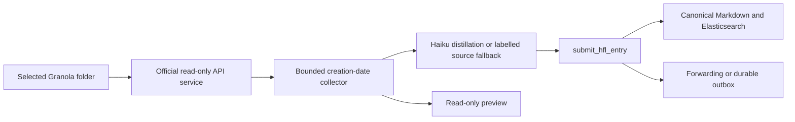

# Granola HFL ingestion: first implementation

Implementation record dated 2026-10-20. The broader research and conversation
memory design is published in [thesis PR #157](https://github.com/brianbartilet/harqis-work/pull/157).
This code delivery implements its optional capture adapter as explicitly
requested, independently of the proposed evidence-projection and briefing phases.

## Scope and comparison

| Input | Current strength | What this implementation changes |
| --- | --- | --- |
| [write-notes](../../.agents/skills/write-notes/SKILL.md) | Explicit user interpretation, attachments, reminder intent, reviewed edits | Nothing; remains the direct route for deliberately authored memory |
| [Plaud](../../workflows/hfl/tasks/ingest_plaud.py) | One HFL entry per recording, transcript acquisition and bounded transcription fallback | Nothing; remains useful when speech is already recorded |
| [Granola](../../apps/granola/README.md) | Desktop meeting capture and enhanced notes guided by rough notes | Adds selected summaries as one provenance-linked HFL entry per note |

Granola does not replace HARQIS actions, semantic duplicate review, later-evidence
checks, entity Souls, or Activity Radar. Those capabilities already exist.
Meeting briefs, structured conversation observations, and source-to-action
reconciliation remain future work, not functionality shipped by this importer.

Use Granola when it reduces missed online calls or cleanup effort. If notes and
Plaud already cover the conversations, no additional source is needed. Evaluate
5–10 meetings for capture coverage and time saved before enabling a schedule.

## Verified vendor contract

Official documentation checked on 2026-10-20:

- [API introduction](https://docs.granola.ai/introduction): Bearer API keys and
  processed meeting-note access on Business/Enterprise.
- [List Notes](https://docs.granola.ai/api-reference/list-notes): opaque cursor
  pagination, creation/update filters, folder selection.
- [Get Note](https://docs.granola.ai/api-reference/get-note): summaries, private
  notes, source URL, calendar metadata, optional transcript.
- [Get Transcript](https://docs.granola.ai/api-reference/get-transcript):
  paginated transcript access.
- [List Folders](https://docs.granola.ai/api-reference/list-folders):
  folder IDs and pagination.

The implementation exposes these four read endpoints. Webhook and audit
administration are intentionally outside the read-only service scope.

## Runtime decision

**Classification:** Celery. **Confidence:** high.
**Execution owner:** the Granola app performs bounded reads; the HFL task distils
and submits entries; the canonical persistence boundary owns storage/delivery.
**Schedule owner:** manual while disabled; Celery Beat owns the supplied daily
23:30 schedule after explicit activation. HFL is already registered; no new
workflow category or `workflows/config.py` merge is added.

**Controls:** folder selection, strict IDs, bounded pages/notes/text, stable
source dedup key, explicit synthesis provenance, source references, and honest
delivery receipts. **Agent responsibility:** none inside this fixed pipeline.
**Review artifact:** task result/Elasticsearch logging and HFL entry receipts.
**Open validation:** authenticated API behavior requires a configured account;
synthetic tests cannot establish production permissions or transcription quality.

## Data flow

The default window is the last seven Singapore calendar dates including today.
The API receives UTC bounds; the collector rechecks creation dates locally.
The HFL timestamp uses note creation time so calendar rescheduling cannot move
a retry into another daily corpus file. Scheduled meeting start is preserved
as `Meeting time` in the entry, falling back to creation time when unavailable.
A note created today can describe an earlier meeting.

Per run: at most 20 notes by default (hard limit 100), five metadata pages
(hard limit 20), and 30,000 summary characters per note. Truncation is disclosed
in the entry. A cap or failure produces `partial=true`; `next_cursor` resumes
the same date window and folder. Failed note details retain their page's cursor
so a replay cannot silently skip them. There is no automatic persistent cursor.

Only summary fields enter the distiller. Private notes and transcripts remain
outside the ingest/model payload. The upstream summary is already AI-generated,
so `synthesized=true` applies even if HARQIS uses its raw fallback.
`distilled` and `model` separately report whether HARQIS made a successful LLM
transformation. Malformed/failed model output falls back to labelled source text.

## Persistence and explicit limits

Each eligible note calls `submit_hfl_entry` once, with `source=granola` and
`dedup_key=granola:<note-id>`. Run on one canonical HFL execution identity:
existing entry-ID generation also includes machine provenance.

The shared persistence replay path now indexes the retained canonical Markdown
entry when replacement is disabled. This prevents a repeated distillation or
edited source from silently updating Elasticsearch while Markdown stays unchanged.

This is **initial capture**, not a mirror:

- Reruns retain the first saved entry; edits do not overwrite it.
- No source deletion or permission-revocation synchronization is implemented.
- A note added late to the selected folder can fall outside the creation window;
  use a wider explicit backfill to capture it.
- A processed note appearing after the overlap window needs a dated backfill.
- Repeated runs can repeat source reads/model calls before persistence
  deduplicates; no pre-distillation checkpoint or cost-free replay is claimed.
- High-volume windows require manual cursor continuation. Do not enable the
  default schedule if repeated caps prevent full coverage.
- Credentials are never sent to a URL supplied by note content.

Results distinguish submitted attempts from newly persisted entries. Duplicate,
forwarded, and outbox receipts do not increase `entries_written`. A forwarded
receipt does not establish indexing; callers inspect each receipt's `indexed`
and `delivery`. Outbox replay uses the existing HFL recovery mechanism.

Before scheduling, select only material appropriate for independent retention.
Revoking a Granola key stops future reads but does not erase HFL copies. Manage
retained entries through existing canonical HFL controls. Full ongoing sync
requires the revision/deletion design in the original thesis.

## Skill composition and validation

- [create-new-service-app](../../.agents/skills/create-new-service-app/SKILL.md):
  service, DTO, configuration, live smoke surface, documentation.
- [create-new-mcp](../../.agents/skills/create-new-mcp/SKILL.md): four shared
  CLI/MCP tools, lazy catalog, existing server/bridge consumers.
- [create-new-ingest-source-hfl](../../.agents/skills/create-new-ingest-source-hfl/SKILL.md):
  prompt, task, explicit registration, disabled schedule, preview, persistence.
- [create-new-workflow](../../.agents/skills/create-new-workflow/SKILL.md):
  runtime/data-flow design only; the ingest skill owns HFL task scaffolding.

Tests cover missing credentials/folder, empty windows, pagination and caps,
midnight boundaries, failed-detail replay, duplicate IDs, repeated cursors,
deleted/malformed notes, truncation, model fallback, source timestamps,
persisted/forwarded/outbox contracts, DTO deserialization, tool discovery, and
read-only previews. Live smoke tests are opt-in and do not write HFL.

Validation on 2026-10-20: 91 passed, five skipped, one deselected across the
ingestion, persistence, source-health, shared catalog, dependency detector, and
Granola app suites. The deselected source-health registry coverage test also
fails on unchanged `main` at `b7cd5cee` because `persona_audit` lacks registry
coverage. It is a baseline failure, not repaired here. Compilation, Celery task
registration, all four read-only CLI schemas, documentation links, and generated
skill-copy checks passed. No authenticated Granola calls or live HFL imports
were performed.

Activation, recovery, CLI discovery, and test commands are in the
[app guide](../../apps/granola/README.md) and
[HFL guide](../../workflows/hfl/README.md#granola-activation).
Rollback disables the schedule and revokes the optional key; existing notes,
Plaud, actions, and radar continue unchanged.
