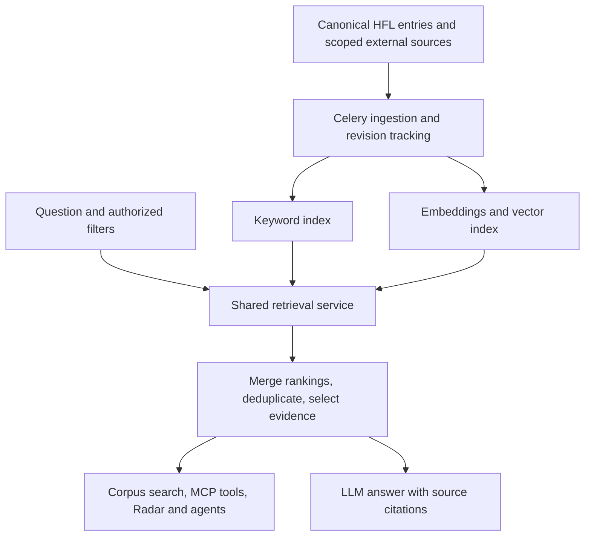

# LangChain and Vector Retrieval for HARQIS-Work

Date: 2026-09-24  
Status: Research and architecture proposal; no implementation or deployment performed.

## Recommendation

Improve HARQIS's existing retrieval layer, connect it to Activity Corpus recall, and introduce LangChain selectively where its interfaces and integrations reduce implementation work. Start with a bounded semantic HFL recall pilot using the existing sqlite-vec store. Choose a larger database only after measuring retrieval quality, latency, concurrency, and operating cost.

The proposed Express path is immediate: a user or agent asks a question and receives relevant evidence with links to canonical entries or source artifacts. This supports the [manifesto](../MANIFESTO.md)'s recall, provenance, and CODE principles.

Related designs:

- [RAG workflow](RAG-WORKFLOW.md)
- [Knowledge Radar phases 1 and 3](KNOWLEDGE-RADAR-PHASE1-3.md)
- [Connected HFL knowledge](CONNECTED-HFL-KNOWLEDGE.md)

## Concepts

| Component | Purpose | HARQIS relationship |
| --- | --- | --- |
| Embedding model | Converts text into vectors representing meaning | Existing Gemini embedding wrapper |
| Vector database | Stores vectors and retrieves similar passages | Existing sqlite-vec integration |
| Retriever | Selects evidence for a question and its filters | Existing knowledge retriever |
| Retrieval-augmented generation (RAG) | Supplies retrieved evidence to an LLM for a grounded answer | Existing `knowledge_ask` tool |
| LangChain | Provides reusable interfaces and integrations for retrieval and model workflows | Optional adapter and experimentation layer |

LangChain is a framework, not a vector database. Adopting it and choosing a storage engine are separate decisions. Its retrieval documentation supports connecting an existing knowledge base rather than rebuilding one. [LangChain retrieval](https://docs.langchain.com/oss/python/deepagents/retrieval)

Semantic search can match an HFL entry about juggling deadlines to a question about competing priorities even when the words differ. Exact identifiers, dates, statuses, and exhaustive reporting still need keyword or structured retrieval.

## Current repository architecture

The repository already implements much of a RAG pipeline:

| Area | Evidence | Observed behavior |
| --- | --- | --- |
| Source ingestion | [Knowledge workflow](../../workflows/knowledge/README.md) | Ingestors exist for Confluence, Jira, Notion, GitHub, and Drive |
| Embeddings | [Shared embedder](../../workflows/knowledge/embed.py) | Central query/document embedding entry points; configured default is `models/gemini-embedding-001` |
| Vector persistence | [SQLite store](../../apps/sqlite_vec/store.py) | Chunk payloads and vectors, upsert, nearest-neighbor search, source metadata, references |
| Retrieval | [Retriever](../../workflows/knowledge/retriever.py) | Question embedding followed by nearest-neighbor search and context formatting |
| Answer generation | [Answer task](../../workflows/knowledge/tasks/answer.py) | Retrieved context supplied to an Anthropic model; returns answer and source hits |
| Agent access | [Knowledge MCP tools](../../workflows/knowledge/mcp.py) | `knowledge_search` and `knowledge_ask` expose retrieval and answering |
| Scheduling | [Task configuration](../../workflows/knowledge/tasks_config.py) | Guarded exports for scoped ingestion and reports; definitions do not establish live execution |
| Corpus recall | [Corpus implementation](../../frontend/modules/hfl_corpus/corpus.py) | The inspected `search_documents` path uses text, tags, source, and date filtering |
| Derived HFL knowledge | [Connected HFL tasks](../../workflows/knowledge/tasks/connected_hfl.py) | Bounded Celery processing for corpus entity enrichment and matching |

These findings come from static code inspection. They do not confirm deployed configuration, provider funding, index freshness, corpus size, or production performance. The configured embedding model name is a repository observation, not a verification of current provider availability.

## Useful applications

| Application | Example question | Proposed value |
| --- | --- | --- |
| HFL recall | “When have I solved a similar problem before?” | Retrieve related experiences despite different wording |
| Engineering research | “Why did we choose this deployment approach?” | Retrieve related Jira discussions, Confluence decisions, and implementation references |
| Activity Radar | “Have I repeatedly postponed something important?” | Supply historical evidence for analysis; verify actual commitment status against canonical records |
| Agent preparation | “Implement this feature using our existing patterns” | Supply relevant documentation and past decisions before execution |

Semantic similarity is evidence selection, not proof that two events are related or that an obligation remains open. Answers and suggested relationships should retain provenance and distinguish evidence from inference.

## Proposed architecture

The vector index is a rebuildable projection. Canonical entries and external source documents retain their existing ownership. Celery continues to own bounded ingestion, retries, and projection updates; existing agents consume retrieval through the shared service.

Combine keyword and vector rankings with reciprocal rank fusion (RRF), which merges ranked lists without assuming that keyword scores and vector distances share a scale. Elastic documents this approach for hybrid search. [Elastic hybrid search](https://www.elastic.co/docs/solutions/search/hybrid-search)

Preserve existing structured search for questions such as “list every commitment last month.” A semantic top-k result set cannot guarantee completeness. Route questions requiring complete counts, statuses, or timelines to the relevant canonical query path.

### Retrieval contract

Extend the existing retrieval boundary with explicit filters and a stable result shape. Suggested fields are:

- Inputs: question, result limit, source, workspace/access scope, date range, and optional entity identifiers.
- Evidence: chunk ID, canonical entry or document ID, revision, text, source reference, occurrence date, and retrieval method.
- Diagnostics: index version, freshness, per-stage latency, and ranking information.

Derive authorization scope from the authenticated caller. Apply it to each retrieval branch before evidence reaches the caller or LLM. Return entry-level references so users can inspect the evidence behind each result.

## Implementation concerns to address first

### Source filtering during vector search

The current SQLite query joins `vec_chunks` to `chunks` and filters `c.source`. This pattern can filter the global nearest results rather than select the nearest results within a source, yielding fewer useful matches. This is a code-review concern, not a reproduced failure in this environment.

Add a regression scenario where global nearest neighbors belong to another source. Investigate supported vec0 metadata or partition filtering for the installed version, or another correctly scoped retrieval strategy. Increasing the candidate count alone does not guarantee complete filtered results. [Current store](../../apps/sqlite_vec/store.py), [upstream JOIN filtering discussion](https://github.com/asg017/sqlite-vec/issues/196), [sqlite-vec KNN documentation](https://alexgarcia.xyz/sqlite-vec/features/knn.html)

### Complete document revisions

Confluence ingestion upserts numbered chunks. If a document shrinks, old trailing chunks can remain because incremental upsert does not replace the complete document chunk set.

Introduce document-level revision replacement and deletion handling. Use namespaced IDs such as `source:document_id:chunk_id`, remove superseded chunks, and avoid publishing partial revisions if embedding fails midway. Follow canonical changes for HFL projections, with bounded reconciliation for missed updates. [Confluence ingestion](../../workflows/knowledge/tasks/ingest_confluence.py)

### Embedding compatibility

Record embedding provider, model, dimensions, normalization, and chunking version with the index. Matching dimensions do not make different models compatible. Rebuild into a separate index generation when these settings change, validate it, then switch readers with a rollback path.

### Scope, dates, and provenance

Carry canonical IDs, revisions, source references, workspace/access metadata, and relevant dates through chunking and retrieval. Distinguish an event's occurrence date from ingestion or modification dates. Treat retrieved text as evidence, not executable instructions.

### Retrieval evaluation

Evaluate evidence selection independently of answer generation. Start with a small curated set of real HARQIS questions and expected source entries, covering paraphrases, exact identifiers, date/source restrictions, deleted or changed documents, and questions with no supporting evidence.

Measure:

- Whether expected evidence appears in the top five results.
- Citation correctness and answer support.
- Stale, duplicate, or out-of-scope results.
- Retrieval and answer latency separately.
- Embedding usage, generation usage, and indexing cost.

Choose acceptance targets before enabling the feature broadly. Compare existing search, vector-only retrieval, and hybrid retrieval on the same questions.

## Where LangChain fits

A thin optional adapter around HARQIS's retrieval service is the preferred initial integration. LangChain retrievers accept a query and return `Document` objects, allowing existing storage and ingestion logic to remain behind that boundary. [LangChain retriever integrations](https://docs.langchain.com/oss/python/integrations/retrievers)

Use LangChain when a concrete integration or experiment saves work, such as comparing retrieval backends or composing document-processing components. Keep HARQIS domain identifiers, authorization, canonical writes, and scheduling under the existing application contracts.

Adding a framework will not fix stale indexing, missing filters, weak chunking, or poor evidence selection. Measure those independently. Any dependency adoption should include compatibility checks against the repository's Python environment and pinned package versions.

## Storage options

| Option | Fit for HARQIS | Decision gate |
| --- | --- | --- |
| Existing sqlite-vec | Lowest-change starting point for a bounded pilot on the canonical host | Benchmark corpus size, filters, concurrent reads/writes, and persistence requirements |
| Elasticsearch | First server-backed candidate to investigate because HARQIS already integrates it | Verify deployed version, capacity, index mappings, and feature licensing; existing logging integration alone does not establish search readiness |
| Qdrant | Candidate when a dedicated vector service is justified; supports hybrid queries | Demonstrate benefit sufficient to justify another service and its backup/monitoring needs |
| pgvector | Candidate if PostgreSQL becomes part of the broader architecture | Assess operational fit and query needs before adding PostgreSQL solely for vectors |

Official references: [sqlite-vec KNN](https://alexgarcia.xyz/sqlite-vec/features/knn.html), [LangChain Elasticsearch integration](https://docs.langchain.com/oss/python/integrations/vectorstores/elasticsearch), [Qdrant hybrid queries](https://qdrant.tech/documentation/search/hybrid-queries/), [pgvector](https://github.com/pgvector/pgvector).

No universal corpus-size migration threshold is proposed. Vector dimensions, filters, hardware, concurrency, and latency targets all affect the decision.

## Suggested delivery sequence

1. **Establish the baseline.** Inspect deployed index health and configuration, choose a bounded HFL sample, and curate evaluation questions. Define the visible output as cited recall results.
2. **Harden indexing and retrieval.** Address scoped search, complete revisions, namespaced IDs, embedding compatibility, and canonical provenance.
3. **Build the HFL projection.** Reuse canonical entry identities and revision events; add bounded retry/reconciliation behavior without creating a second capture system.
4. **Add hybrid recall.** Expose keyword-plus-vector evidence through the shared retrieval boundary and existing Corpus/MCP surfaces. Preserve structured queries for exhaustive requests.
5. **Evaluate the pilot.** Compare retrieval quality, answer support, freshness, latency, and cost. Keep a usable keyword path when embeddings are unavailable.
6. **Decide on optional expansion.** Adopt a LangChain adapter or server-backed store only where evaluation establishes a benefit. Extend validated retrieval to Radar and agent preparation.

Before implementation, apply the repository's automation-runtime and workflow conventions to confirm ownership and scheduling. This document proposes research direction and a bounded pilot; it does not enable ingestion, call paid providers, or change deployment settings.
