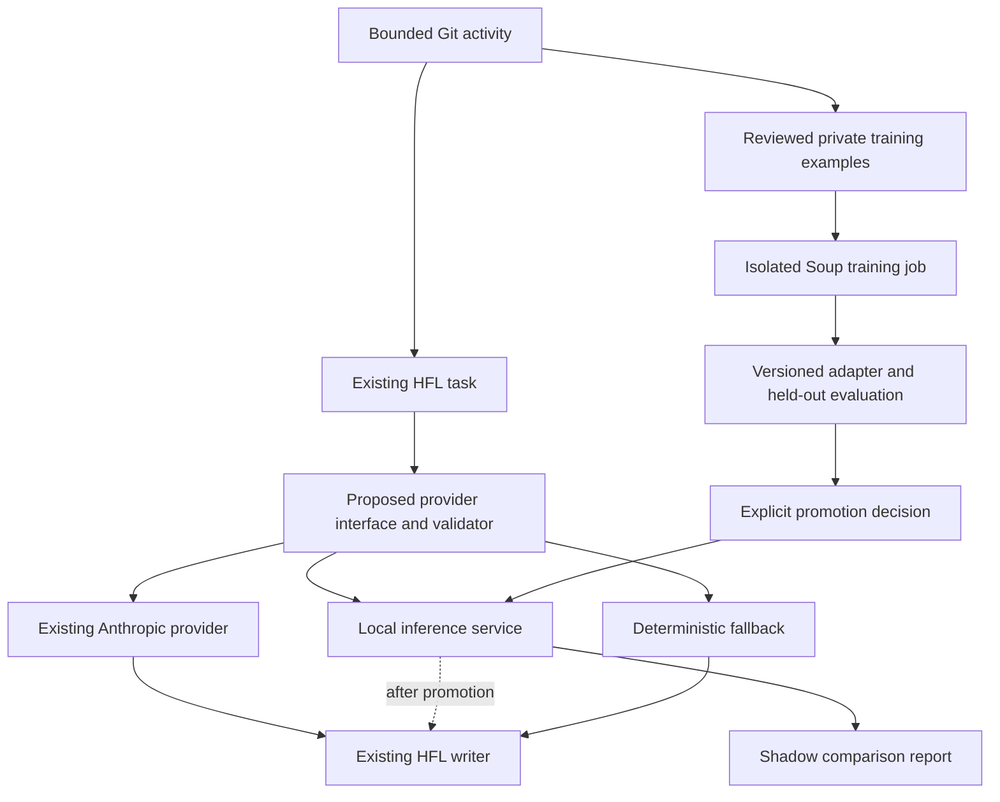

# Soup model training for HARQIS HFL

Date: 2026-09-29

Status: Implementation thesis and experiment specification. This change adds
documentation and synthetic examples only. The provider adapter, dataset
exporter, evaluator, shadow runner, and production controls below are proposed,
not implemented. No model has been trained or deployed for this thesis.

Read next: [experiment usage guide](../info/SOUP-HFL-PILOT-GUIDE.md) and
[example assets](../examples/soup-hfl/README.md).

## 1. Thesis and intended outcome

A small model adapted to HARQIS's repeated HFL transformations may produce
useful, factual entries with lower operating cost or less external data
processing. Begin with **Git activity to one structured HFL entry**. Compare
the existing provider, a prompted local base model, and the same model tuned
with Soup. Adopt training only if it adds measurable value.

The Express output is a grounded HFL entry available through existing corpus
recall and weekly summaries. During experimentation the output is instead a
comparison report, with no candidate writes to the corpus. This implements
the [manifesto](../MANIFESTO.md)'s Capture, Organize, Distill, Express cycle:

| Stage | Proposed operation | Review evidence |
| --- | --- | --- |
| Capture | Save bounded source activity and reviewed corrections | Source IDs, revisions, scope, and retention decision |
| Organize | Deduplicate, redact, and partition examples | Dataset manifest and split audit |
| Distill | Compare baseline and tuned model outputs | Field validation, factual review, skip errors |
| Express | Publish an experiment report; later write approved model outputs through existing ingestion | Promotion decision and attributed execution receipts |

Keep evolving facts in the corpus and retrieve them when needed. Training
teaches formatting, summarization behavior, and preferences. It does not
replace [retrieval](LANGCHAIN-VECTOR-RETRIEVAL.md), source provenance, permission
checks, or the general reasoning agents.

## 2. Product evidence and limits

Soup CLI is an Apache-2.0 project for model post-training. Its documentation
describes supervised fine-tuning (SFT) and preference methods such as DPO.
SFT learns from reviewed input/output pairs; DPO learns from preferred and
rejected responses. Start with SFT because the proposed task has a fixed
output shape. [Project](https://github.com/MakazhanAlpamys/Soup),
[training methods](https://trysoup.dev/docs/training).

Soup Zero's desktop workbench is presented as a concept preview. The site
identifies CLI fine-tuning, evaluation, and deployment as available, while
several surrounding workbench features remain in development. The pilot
depends on the CLI, not the desktop roadmap.
[Product status](https://trysoup.dev/zero).

Soup documents Python 3.10–3.12 and recommends CUDA hardware. Its layer-streaming
path is beta; advertised small-VRAM measurements do not establish performance
for this dataset, context length, hardware, or serving workload. Keep training
dependencies outside the HARQIS environment.
[Installation](https://trysoup.dev/docs/getting-started).

Evaluation gates can compare scores against thresholds and baselines. They
are a mechanism for enforcing our rubric, not independent proof of factual
quality. Supplement them with human review of held-out source/output pairs.
[Evaluation gates](https://trysoup.dev/docs/eval-gate).

Evidence was reviewed on the date above. This is a documentation assessment,
not a hardware benchmark, security audit, or verification of every advertised
feature. Before executing, verify the selected package release and its local
CLI help; upstream web pages and installed versions can differ.

## 3. Existing repository behavior

| Location | Observed behavior | Consequence for the pilot |
| --- | --- | --- |
| [Git ingestion](../../workflows/hfl/tasks/ingest_git.py) | `distill_git_activity` directly constructs `BaseApiServiceAnthropic`; defaults to Haiku | A different model name alone cannot select a local endpoint |
| [Git prompt](../../workflows/hfl/prompts/ingest_git.md) | Requests six JSON fields and source-grounded summaries | Reuse and hash the exact prompt for fair comparisons |
| [Shared parsing helper](../../workflows/hfl/distill.py) | Extracts JSON, but is not a complete field/schema validator | Add explicit type and length checks at the provider boundary |
| [Git ingestion writer](../../workflows/hfl/tasks/ingest_git.py) | Uses a deterministic fallback; empty activity bypasses synthesis; `skip` suppresses writing | Preserve availability and measure false skips separately |
| Same writer | Builds persisted tags from `git`, `commits`, and repository names | Model tag improvements are not yet a user-visible benefit |
| [HFL capture](../../workflows/hfl/tasks/capture.py) | Existing entry construction and persistence | Reuse canonical writing; no model-specific corpus writer |
| [HFL MCP](../../workflows/hfl/mcp.py) | Reuses plain Git collection/distillation functions | Keep default read-only behavior and existing signatures compatible |

The Git module currently retains its own JSON parser. Do not claim that
changing the shared parser updates this call site. The provider refactor must
explicitly migrate or invoke validation there.

These are static observations at the PR base. They do not establish production
task volume, API spend, available training data, or deployed machine capacity.

## 4. Scope and architecture

The first pilot covers Git activity only, with bounded inputs and no tool use.
Potential later applications include HFL categorization, user-edited summaries,
and Jira-to-Gherkin formatting. Each needs its own data and acceptance tests.
General autonomous coding and automatic model promotion are outside this pilot.

Soup's serving documentation describes `/v1/chat/completions`, `/v1/models`,
and `/health`. A narrow HTTP adapter can consume these without adding training
libraries to Celery workers. The docs also advise separating vLLM serving
dependencies from training dependencies.
[Serving](https://trysoup.dev/docs/serving).

### Proposed provider contract

Inputs: source name, source payload, system prompt, prompt hash, model identity,
token limit, total deadline, source references, and caller-authorized scope.
Source text is untrusted data; it must not change tools, destinations, or policy.

Successful output contains:

| Field | Contract |
| --- | --- |
| `skip` | Boolean; never coerce the string `"false"` to a truthy value |
| `moment` | String; at most 120 characters |
| `what_happened` | String; factual summary of supplied evidence |
| `why_it_stayed` | String; may be empty when evidence does not support a reason |
| `possible_use` | String; suggested reuse such as `standup` or `retro` |
| `tags` | List of 2–6 short strings without `#` for non-skipped entries |

All six fields are required. Non-skipped entries require nonempty `moment`
and `what_happened`. Skipped entries may have empty prose and tags. Reject
unknown fields and wrong types. Require one JSON object; schema validity does
not certify factuality. Runtime input/output limits must be explicit and
measured against the selected model; do not silently truncate away evidence.

Return diagnostics separately: provider, base revision, adapter digest, prompt
hash, latency, token counts when available, fallback reason, and correlation ID.
The caller owns `synthesized`; the model cannot assert it. References and event
timestamps come from source metadata, never model-generated URLs or dates.

### Routing and failure behavior

Proposed modes are `baseline`, `shadow`, and `local`; these are design names,
not existing HARQIS configuration options.

- `baseline`: preserve the existing Anthropic path and deterministic fallback.
- `shadow`: baseline alone determines corpus output. An independent bounded
  candidate call creates a comparison artifact and cannot write or suppress
  an entry. Candidate failure must not delay or fail baseline persistence.
- `local`: use the validated candidate; on timeout, unavailable service,
  invalid JSON, wrong schema, or truncated completion, use the declared fallback.

Default local failure behavior is the deterministic summary. Cloud fallback
must be a separate explicit policy because it changes where source data goes.
Do not retry a malformed generation indefinitely. Define one overall deadline,
at most one transient transport retry, and a circuit breaker for repeated
service failures. Empty input performs no inference.

A valid `skip: true` cannot be proven correct by a schema check. Initially,
route candidate skips to deterministic summaries in local mode; enable skip
suppression only after the dedicated skip evaluation passes. Preserve source
evidence so an erroneous skip can be investigated and replayed.

## 5. Automation runtime decision

**Classification:** celery for the proposed bounded production transform.
**Confidence:** high for that boundary; hardware and economics remain unmeasured.
**Reasoning:** fixed inputs, output schema, and failure policy require durable
execution rather than adaptive agent planning.
**Execution owner:** existing HFL Celery task owns collection and persistence;
provider adapter owns bounded inference; a separate manually launched process
owns Soup training; the operator reviews labels and promotion decisions.
**Schedule owner:** existing Celery Beat ingestion schedule. Training and
promotion have manual triggers; there is no new automatic retraining schedule.
**Celery operations:** collection, validated transformation, canonical write,
and later bounded shadow dispatch if its implementation needs durability.
**Agent responsibilities:** optional research and report interpretation only;
no autonomous training, deployment, or duplicated collection loop.
**Required controls:** private dataset scope, source revision and prompt hashes,
correlation IDs, bounded inference, source-based write identity, and artifact
digests. Record skill name/hash if a skill-guided agent prepares a report.
**Review artifact:** experiment manifest, comparison report, and promotion record.
**Open questions:** available GPU, private dataset size, model license, provider
terms for any generated training examples, and observed baseline cost.

Before extending schedules, apply the
[runtime guide](../info/AUTOMATION-RUNTIME-GUIDE.md). A changed model must not
create a second ingestion schedule or duplicate corpus entries. Confirm the
canonical writer's current deduplication behavior during implementation; use
source/window/revision identity, not model identity, as the write key.

## 6. Dataset and feedback design

Start with a few hundred reviewed examples if available; this is an experiment
budget, not a claim that this quantity guarantees quality. Synthetic examples
in this PR demonstrate serialization only and cannot support quality claims.

Each private manifest record should retain:

- Stable example ID, source/window identity, revisions, and source references.
- Input hash, exact prompt hash, reviewed target, and reviewer/date.
- Collection scope, redaction status, permitted use, and retention deadline.
- Split assignment and related-event group ID; teacher/provider identity if used.

Export only the model-visible messages to training JSONL. Keep provenance in a
separate private manifest, mapped by example ID and line number. A final HFL
entry without its source material is insufficient for grounded training.

Suggested split: 70% training, 15% development, 15% held-out test, adjusted to
retain representative skip and meaningful-activity cases. Split event groups
before producing variants or preferences. Keep the newest windows for temporal
testing and add a separate unseen-repository slice where data permits. Keep
related commits, repeated dumps, paraphrases, and corrections in one partition.
Freeze the test set before tuning; report per-slice sample counts and uncertainty.

Keep raw private data and model artifacts outside the checkout. Review secrets,
names, source ownership, and retention before export. Redaction is a reviewed
step, not a guarantee conferred by running locally. Disable optional remote
tracking/upload for private experiments. Model weights may retain training
information: deleting an entry does not remove it from an existing adapter.
Track affected datasets/adapters and retire or retrain them when necessary.

Later, retain original and corrected responses as preference pairs only when
the correction is verified against the same source. Regeneration alone does
not establish that a later answer is better. Soup supports preference export
from certain trace formats, but HARQIS needs an explicit exporter rather than
assuming its logs are compatible.
[Trace conversion](https://trysoup.dev/docs/trace-to-preference).

## 7. Evaluation and adoption criteria

Compare three arms using the same source payloads, prompt, output limit, and
rubric: current Anthropic workflow, prompted local base, and Soup-tuned local
model. Keep generation settings fixed where supported and record differences.
Also score the deterministic fallback to understand the value of inference.

The following are proposed promotion gates, not achieved results:

| Measure | Initial gate |
| --- | --- |
| Field/type validity | At least 99% before fallback; all persisted results valid after validation/fallback |
| Unsupported facts | No critical fabricated outcome, person, date, or source reference in the reviewed held-out sample |
| False skips | At most 1% of human-labeled meaningful windows; report numerator and denominator |
| Useful summaries | Blinded source-grounded review: at least 90% rated usable with no substantive edit; no worse than baseline |
| Added value of tuning | Better quality than prompted base, or equal quality with a measured operational advantage |
| Reliability | Offline service, timeout, malformed output, context overflow, and breaker recovery preserve ingestion |
| Cost and latency | Fit observed task deadline and show a quantified advantage, or document why local processing justifies added cost |

Treat these thresholds as provisional and register them before evaluating.
A small sample with zero observed errors does not prove a 1% error rate;
report confidence intervals and collect more cases if uncertainty changes the
decision. Reviewers should not know which model produced an answer. Automated
judges can assist but do not replace source-grounded review.

Measure factuality, omissions, verbosity, correct skip decisions, and invented
motivation independently. Include mechanical commits, several repositories,
long inputs, Unicode, misleading commit subjects, embedded instructions, and
cases where a commit records an implementation but not successful deployment.
Evaluate persisted tags separately because the current writer overrides them.

Monthly benefit = avoided API charges minus serving costs, training amortization,
fallback API charges, and review/maintenance time. Use measured tokens, calls,
fallback rate, GPU utilization, and regional energy/rental prices. No savings
percentage or break-even date is assumed by this thesis.

## 8. Implementation sequence and file plan

All new paths in this table are proposals. No CLI commands for these components
exist as part of this documentation change.

| Phase | Proposed work | Exit criterion |
| --- | --- | --- |
| 0: baseline | Record volume/cost and curate reviewed private pairs; freeze an evaluation rubric | Data permission, prompt version, and baseline report recorded |
| 1: provider boundary | Add `workflows/hfl/distill_provider.py`; migrate only `distill_git_activity`; preserve existing default | Provider selection, schema validation, deadlines, and fallback behavior verified |
| 2: experiment tooling | Add bounded helpers under `workflows/hfl/model_training/` for export, grouped splits, comparison, and manifests | Reproducible private dataset and three-arm report without corpus writes |
| 3: training | Run Soup in an isolated environment; preserve package lock, model/tokenizer revision, config, data hashes, and adapter digest | Candidate passes held-out evaluation; license and hardware fit recorded |
| 4: shadow | Add write-free candidate dispatch and correlated diagnostics | At least 50 representative nonempty windows across at least 14 days, or remain in shadow until enough evidence exists |
| 5: controlled rollout | Add explicit mode selection and immutable candidate identity | Canary cohort meets gates; rollback demonstrated |
| 6: expansion | Review other HFL sources or preference training separately | Each task has its own evidence and output contract |

A future service wrapper belongs under `apps/` only if shared integration needs
justify it; follow the existing app scaffolding conventions then. Do not add an
MCP training/deployment surface merely to expose every Soup operation.
Update workflow documentation and host configuration templates in the code PR.
Keep heavy training libraries out of repository-wide runtime requirements.

## 9. Verification, deployment, and rollback

Implementation tests should cover behavior, including baseline compatibility,
wrong JSON types, missing fields, hallucinated reference rejection, no-call
empty input, timeout fallback, denied cloud fallback, skip handling, immutable
model selection, and zero candidate writes in shadow mode. Use the repository
environment bootstrap and test skill when running tests that import workflows.

Integration verification must exercise the selected Soup release and actual
HTTP backend, including response model IDs, token limits, termination reasons,
and auth behavior. A parseable YAML file is not proof that training or serving
works. Keep training and serving environments independently reproducible.

Promote an immutable artifact only after reviewing the evaluation report. Record
base/tokenizer revision, adapter digest, dataset and prompt hashes, runtime
versions, reviewer, and previous model identity. Canary a deterministic cohort
of windows before full rollout; only one route may write each window.

Rollback switches routing to the previous baseline or deterministic fallback,
stops candidate dispatch, and retains diagnostics. It must not replay completed
writes or delete corpus history. Incorrect entries are corrected through the
canonical revision path. Revoked/private examples must be traceable to affected
adapters. Runtime credentials are never included in published model artifacts.

## 10. How to use this thesis

1. Read the [guide](../info/SOUP-HFL-PILOT-GUIDE.md) and inspect the synthetic
   examples without installing a training stack.
2. Run the documented isolated Soup smoke experiment only when hardware and
   package compatibility have been checked; it establishes mechanics only.
3. Use phases 0–2 as the first implementation ticket. Build the provider and
   evaluator before making any production model change.
4. Attach measured results to the promotion record. If the prompted base wins,
   use that result; if baseline remains best, retain it and keep the evaluator.
